# ICD-10-CM KEV Dataset Builder

A Python 3.11+ project that builds a version-locked ICD-10-CM knowledge base,
generates synthetic English outpatient notes using a model deployment in
Microsoft Foundry, and exports reviewed cases and hierarchical Kev tasks.
The model client uses the Azure OpenAI-compatible API.

## Contents

- [Overview and design](#overview-and-design)
- [How the training data is designed](#how-the-training-data-is-designed)
  - [Worked example](#worked-example-from-note-to-training-tasks)
  - [Candidate sets](#candidate-sets-during-training-and-inference)
  - [Proposed improvements](#proposed-improvements-at-a-glance)
- [Setup: official reference data](#setup-official-reference-data)
  - [Setup and commands](#setup-and-commands)
- [Usage](#usage)
  - [Run a 1,500-slot trial](#run-a-1500-slot-trial)
  - [Checking status during a run](#checking-status-during-a-run)
  - [Stopping and resuming](#stopping-and-resuming)
  - [Full run](#full-run-not-started-automatically)
  - [Outputs](#outputs-dataoutput)
- [Technical design](#technical-design)
  - [Goal and scope](#goal-and-scope)
  - [Research objectives](#research-objectives)
  - [Official sources and release](#official-sources-and-release)
  - [Pilot target codes](#pilot-target-codes)
  - [Reference knowledge base](#reference-knowledge-base)
  - [Plan, quotas, and state](#plan-quotas-and-state)
  - [Generation, validation, and review](#generation-validation-and-review)
  - [Master records and Kev tasks](#master-records-and-kev-tasks)
  - [Hierarchy and candidate selection](#hierarchy-and-candidate-selection)
- [Dataset card: 1,500-slot trial](#dataset-card-1500-slot-trial)
  - [Quality checks and limitations](#quality-checks-and-limitations)
- [Fine-tuning with Kev](#fine-tuning-with-kev)
  - [Intended use of the fine-tuned model](#intended-use-of-the-fine-tuned-model-design-not-implemented-here)
- [Evaluation strategy and next steps](#evaluation-strategy-and-next-steps)
- [Tests](#tests)
- [License](#license)

## Overview and design

The pipeline uses these CLI commands. Only the starred stages call the model:

```
sources import -> kb build -> kb audit -> kb pilot -> plan
   -> generate* -> review* -> audit -> finalize -> export-kev
```

The builder creates data for a coding-assistance experiment, not an
autonomous coding system. Rather than present the whole ICD-10-CM catalogue
as one flat choice, the proposed approach breaks selection into smaller
hierarchical decisions. An early mistake can still rule out the correct code,
so routing, stopping, evidence and out-of-scope handling all need evaluation.
The intended downstream flow is a medical description → hierarchy decisions
→ a complete code → supporting text.

```mermaid
flowchart LR
  CDC[Official CDC files] --> Lock[Import and source lock]
  Lock --> KB[Codebook, hierarchy and reference chunks]
  KB --> Plan[Seeded slots and scenario families]
  KB --> Context[Bounded reference packets]
  Plan --> Gen[Foundry model: synthetic narrative generator]
  Context --> Gen
  Gen --> Validate[Schema, source and leakage checks]
  Validate --> Review[Blind model recode and lexical dedupe]
  Review --> State[(SQLite accepted cases and audit)]
  State --> Export[Master and Kev task exports]
  Export -. future experiment .-> Kev[Fine-tuned Kev with supplied options]
  KB -. future reference .-> Controller[Hierarchy controller and rule checks]
  Kev -. decisions .-> Controller
  Controller -. future .-> Evidence[Evidence and qualified review]
```



Solid arrows describe the builder; dashed arrows represent a proposed
downstream system. Kev still needs supplied options, and a future controller
must choose candidates, manage branching and stopping, and connect decisions
to evidence and coding-rule checks. The stored gold path is not a trace of
that future controller.

| Stage | Module | Offline? | What it does |
|---|---|---|---|
| sources / kb | `sources.py`, `kb.py` | yes | Hash-locks official CDC files; builds codebook, tabular-source hierarchy, index/guideline chunks |
| kb pilot | `reference.py` | yes | Slices the hierarchy into the 50 pilot branches (`pilot_context.json`) |
| plan | `planner.py`, `state.py` | yes | 4,500 quota slots (3,000 / 500 / 1,000), scenario families kept in one split, SQLite state |
| generate | `generation.py`, `llm.py` | **no** | Batches planned slots, builds sanitized prompts, validates output, stores *candidates* |
| review | `review.py`, `dedupe.py` | **no** | Local checks, blind model re-code, exact/near-duplicate and cross-split leakage checks, transactional acceptance |
| audit / finalize | `reports.py` | yes | Quota/shortfall and split-integrity audit; master JSONL, reports, dataset card, review sample |
| export-kev | `kev.py` | yes | Derives routing, no-match and evidence tasks from accepted records |

Key design rules:

- **Reference facts and generated text.** Application code assigns codes,
  lineage, splits, IDs, sentence spans, source references and provenance. The
  model writes the narrative and proposes focus sentences, evidence quotes and
  related details. Quotes must match the generated sentences exactly.
- **No inferred hierarchy.** Paths come from the tabular XML, never from code
  prefixes. Unsupported paths are reported, not invented.
- **Code leakage checks.** Generation requests are checked for codes
  forbidden by their reference packets; generated text is checked for those
  codes and all pilot codes, with or without decimals. Original slot and
  family IDs are not sent to the model.
- **Blind review.** The reviewer sees only the note and a fixed bank of the 50
  pilot codes, may answer outside the bank or "unresolved", and is compared with
  the stored label. Outside-pilot agreement accepts the same 3-character
  category as a comparison heuristic (not hierarchy inference). The reviewer
  may share the generator's deployment; that is recorded in provenance and the
  dataset card. Models can never set `human_review` (always `not_run`).
- **Durable, resumable state.** `data/state/plan.sqlite` holds slots, attempts,
  candidates, duplicate decisions and accepted records. Acceptance is
  transactional and unique per slot. Interrupted attempts are marked
  `uncertain_abandoned`; remote exactly-once execution is not claimed. An
  advisory lock (`plan.lock`) refuses concurrent generate/review runs.
- **Bounded attempts.** Each slot gets at most `--max-attempts` (default 3);
  after that it is `exhausted` and reported as a shortfall. Failed examples are
  never silently relabelled to meet quotas. Generation stops after three
  consecutive batches that produce no valid candidates.
- **Cost control.** `--limit` (default 5), `--max-requests` (default 20),
  `--max-tokens` (checked between batches, so the last batch can exceed it),
  `--dry-run`, and `--full-run` (requires an explicit `--max-requests`).
  No prices are assumed or estimated.
- **Untrusted text.** Source text and model output are treated as data.

## How the training data is designed

The dataset teaches a sequence of coding decisions, not a free-text answer. At each step, Kev receives the original note, a description of the current position in the hierarchy, and a set of options. Its supervised answer is the next branch or a control outcome. A downstream controller must connect those decisions into a route.

The intended result is straightforward:

```text
Medical description → selected classification path → complete code
                                              + supporting text
                                              + coding checks
```

This builder supplies reference answers for that experiment. It does not implement the controller or establish that a trained model will reproduce those answers. A path looked up from a reference code is not an actual model trace.

### Why these pilot codes

The 50 codes cover five broad clinical areas and several close distinctions within them. Broad differences test chapter routing; neighboring codes test whether the model uses the details that determine the assignment. The list is an experimental scope, not a ranking of the most common diagnoses.

| Family | Distinctions the examples should cover |
|---|---|
| Diabetes | Documented type, glucose complications, kidney complications and neurological complications |
| Respiratory | Asthma classification and exacerbation status; COPD variants; pneumonia |
| Circulatory | Coronary disease with or without angina, atrial fibrillation type, and heart-failure type |
| Kidney and urinary | Recorded CKD stage, stage 3 subdivisions, ESRD, and unspecified stage |
| Digestive | Reflux, esophagitis, bleeding, gastritis and ulcer distinctions |

A useful example records the information needed to choose between related codes. It should not require the model to diagnose a condition from symptoms, treatment or laboratory results alone. Where a coding convention permits an assignment, that convention needs a reference in the case metadata.

### Cases, tasks and model inputs

One master case can produce many training rows. Those rows share a note and are not independent clinical examples.

| Unit | What it represents |
|---|---|
| Planned slot | A requested case with a split, outcome and scenario specification |
| Accepted master case | One synthetic note and its reference annotations |
| Routing task | One choice at a reference parent, including a terminal STOP task |
| Wrong-branch task | A justified NO_MATCH example at an unsuitable parent or leaf |
| Evidence task | Sentence-level judgments derived from the note |

Keep every task from a case in the same partition. Related scenario families also need to stay together when independence between partitions matters. A distinct case ID is not sufficient evidence that two notes are independent.

| Available to the model | Kept outside the model input |
|---|---|
| Original note | Correct answer label and training target |
| Current parent description | Future reference path and final answer |
| Question and candidate options | Gold evidence summary and reviewer verdict |
| Sentence text for evidence questions | Case, split and task-type metadata used only for tracking |

A code can legitimately occur in the candidate list or current-node description. The leakage concern is disclosing which candidate is correct, not merely displaying code identifiers as options. Check the actual loader and request construction rather than assuming that removing a field named `label` removes every answer cue.

### Worked example: from note to training tasks

The following note is fictional. It illustrates the E11.22 pilot path; it is not a human-reviewed case or a recorded model prediction. Verify executable examples against the locked codebook when preparing a run.

> S1: The clinician documents type 2 diabetes mellitus with diabetic chronic kidney disease.  
> S2: The stage of chronic kidney disease is not specified in this note.

Each row below uses the same original note. The controller context and correct next choice change.

| Step | Current position | Reference answer | What the task teaches |
|---|---|---|---|
| 1 | Root | Endocrine, nutritional and metabolic diseases | Route the focused combination diagnosis |
| 2 | Endocrine chapter | Diabetes mellitus, E08–E13 | Select the disease group |
| 3 | Diabetes group | E11: type 2 diabetes mellitus | Use the documented type |
| 4 | E11 | E11.2: kidney complications | Identify the documented complication |
| 5 | E11.2 | E11.22: diabetic chronic kidney disease | Distinguish the complete code from related alternatives |
| 6 | E11.22 | STOP | End this focused mapping |

The real export uses node IDs and candidates from the reference artifacts. The table is a readable example, not a complete executable candidate list. Other diagnoses have shorter or longer paths.

A wrong-parent task can place this same focused note under an unrelated branch and label it NO_MATCH. An evidence task can ask whether S1 directly documents the focused diagnosis. S2 records a staging limitation; it does not cancel the explicit diabetes-with-CKD diagnosis. Additional CKD coding requirements must be checked separately. Selecting this focused code does not complete all coding for the encounter.

A future application should display the route actually selected, not substitute the reference route after prediction. It should show supporting quotes and any unresolved coding requirements alongside the result.

### Candidate sets during training and inference

Candidate construction is part of the experiment, not a formatting detail.

| Use | May retain a candidate using the known answer? | What the result measures |
|---|---|---|
| Training export | Yes | Learning from answerable supervised choices |
| Reference-parent evaluation | Yes, if disclosed | Local choices under supplied reference context |
| End-to-end inference | No | The controller and model working without the answer |

The current exporter retains the correct child and hash-ranks sibling distractors. Its default budget of 24 includes three controls, leaving room for 21 of the 22 ROOT chapters. That policy is documented below; it is not a deployed candidate-selection algorithm.

A proposed improvement is to use all direct children where the actual question-token budget permits. ROOT would have 25 options with all 22 chapters and the three existing controls. This needs configuration/code changes and tokenizer validation; this README edit does not make that change. Where candidates must be reduced, the runtime policy must work without the gold label, and evaluation must measure whether it excludes the correct code.

### Stopping, scope and review

| Outcome | Meaning | Current data coverage |
|---|---|---|
| STOP | The current node completes the supported focused mapping | Terminal mapped tasks and wrong-leaf contexts |
| NO_MATCH | The current branch does not fit the focused diagnosis | Selected wrong-parent/leaf tasks |
| OUT_OF_SCOPE | The supported result lies outside the pilot | ROOT-level tasks |
| NEEDS_REVIEW | Applicable rules do not resolve the documentation | ROOT-level tasks |

STOP at a supplied final node is easier than deciding whether to stop at a valid node that also has more-specific children. The latter is not covered by the current gold-parent policy. Before adding such training tasks, verify whether those situations occur in the supported release and how code validity is represented; do not assume every category with descendants is reportable.

Prefix-preserving review is another proposed extension. For example, a note may clearly support CKD while contradicting itself about stage. A controller could retain the supported renal-disease path and stop at the unresolved distinction instead of rejecting the note at ROOT. If the diagnosis itself is contradictory, earlier review may be appropriate. Missing detail alone does not require review when a valid unspecified code or coding rule resolves the assignment.

### What counts as supporting evidence

The native exporter derives sentence labels from focus-sentence membership. That is a concrete implementation rule, but focus and sufficient coding evidence are not necessarily the same thing.

A proposed annotation rule is: mark a sentence positive when it explicitly records the focused diagnosis or an attribute needed for its coding. Background symptoms and management plans are not automatically positive or negative. Their role depends on the focused assignment.

Include cases with support spread across sentences, relevant negation and unsupported alternatives. If a task does not include a candidate code, describe it as evidence for the focused diagnosis, not as a verifier for any arbitrary code. Exact-span checks establish that the quote exists; they do not establish that its interpretation is correct.

### Scenario coverage and split design

Writing-style variation is useful but does not replace clinical contrast coverage. The current planner documents style, trait and length controls. A proposed contrast matrix would additionally track the determining clinical attribute, competing values and expected label.

For example, reordering an explicitly documented asthma assessment should preserve its label. Changing the documented exacerbation status may change it. Define those relationships before generating contrast pairs, and keep related cases together when assigning splits. Do not treat a new family ID as proof of a new clinical scenario.

The documented calibration/development subdivision hashes case IDs, allowing some validation families into both sets. A family-grouped subdivision, followed by checks of code and outcome coverage, is recommended before definitive calibration/development comparisons. The existing snapshot remains useful for a trial, with this limitation disclosed.

### Testing the value of fine-tuning

Use the same cases, hierarchy, candidate policy and controller budget for default and fine-tuned Kev. Report complete-code accuracy separately from STOP, NO_MATCH and abstention outcomes. Good accuracy on supplied reference parents does not demonstrate that the model can reach those parents from ROOT.

Input efficiency needs a separate comparison:

| Checkpoint | Described options | Compact options |
|---|---|---|
| Default Kev | Baseline with explanations | Tests whether the baseline already works without them |
| Fine-tuned Kev | Tests domain adaptation | Tests performance with reduced input |

The generic compact export exists; native export currently uses only the described variant. A compact-native experiment therefore needs a compatible exporter change and validation. Keep case IDs, answers and partitions matched across variants.

Fit confidence parameters on the calibration partition, use development for model/configuration decisions, and leave test untouched for final assessment. Use probabilities returned by the actual Kev interface. They are conditional on the supplied options. Multiplying local scores does not automatically produce a calibrated final-code probability.

### Proposed improvements at a glance

These are follow-up decisions, not features implemented by this documentation update.

| Improvement | Reason | Suggested timing |
|---|---|---|
| Complete candidate sets where practical; gold-independent runtime selection | Avoid answer-aware candidate construction in end-to-end evaluation | Before the main model comparison |
| Family-grouped calibration/development | Reduce dependence between the two partitions | Before tuning confidence and drawing definitive conclusions |
| Intermediate stopping supervision, where applicable | Teach continue-versus-stop decisions beyond terminal tasks | After checking supported hierarchy semantics |
| Supported prefixes for review/out-of-scope | Make partial lineage useful without forcing a code | When extending the controller/data policy |
| Explicit evidence annotation policy | Separate focus selection from coding support | Before making evidence-quality claims |
| Clinical contrast planning | Cover label-changing details, not only stylistic variation | Before the next generation round |
| Verified compact-native export | Test the input-efficiency hypothesis fairly | Before an input-efficiency experiment |


## Setup: official reference data

The current implementation supports:

- Importing manually downloaded CDC ZIP/PDF files without modifying the input.
- Downloading only the exact HTTPS URLs in `config/default.toml`, with host and
  redirect allowlisting, bounded retries and sizes, atomic writes, and archive
  safety checks.
- Recording byte hashes, source roles, configured URLs, import times, archive
  member names, release evidence, and addenda handling in `sources.lock.json`.
- Parsing the official code-description archive and tabular/index XML by
  inspecting archive members rather than assuming internal filenames.
- Building a hierarchy from tabular XML containment, retaining coding notes,
  parsing Alphabetic Index entries, extracting guideline PDF text with the
  optional `pypdf` extra, and validating every pilot target against both the
  codebook and its official hierarchy path.
- Binding generated reference artifacts to the source manifest hash.

The CDC files are not bundled. To set up a new virtual environment from the
project root, run:

```bash
python3 -m venv .venv
source .venv/bin/activate
python -m pip install -e '.[pdf]'
```

The PDF extra is needed to parse the guidelines. The OpenAI Python SDK is
installed as a project dependency and is required for the Foundry model client
and generation dry runs. For the offline test suite, also install
`python -m pip install -e '.[test]'`. If your environment is already set up,
you can skip these installation steps.

### Setup and commands

Download the four required files from the
[CDC FY2027 release directory](https://ftp.cdc.gov/pub/Health_Statistics/NCHS/Publications/ICD10CM/2027/)
before running the import commands below. The individual download links and
their purposes are listed under [Official sources and release](#official-sources-and-release).

From the project root, set `PYTHONPATH=src` when running from a checkout, or
install the package in an approved environment. Offline tests need no API key:

```bash
PYTHONPATH=src python -m icd_kev_dataset_builder doctor
PYTHONPATH=src python -m icd_kev_dataset_builder sources import \
  --source-id table_and_index --path /path/to/icd10cm-table-and-index-2027.zip
PYTHONPATH=src python -m icd_kev_dataset_builder sources import \
  --source-id code_descriptions --path /path/to/icd10cm-code-descriptions-2027.zip
PYTHONPATH=src python -m icd_kev_dataset_builder sources import \
  --source-id guidelines --path /path/to/ICD-10-CM-October-1-2026-FY27-Guidelines.pdf
PYTHONPATH=src python -m icd_kev_dataset_builder sources import \
  --source-id addenda --path /path/to/icd10cm-addenda-2027.zip
PYTHONPATH=src python -m icd_kev_dataset_builder kb build
PYTHONPATH=src python -m icd_kev_dataset_builder kb audit
```

`icd-data sources download` is available but is not run automatically. It
downloads all required sources only when explicitly invoked. Optional sources
can be included with `--include-optional`. No Azure API calls or dataset
generation are part of this setup stage.

The four Kev-native JSONL files under `data/output/kev/native/` are intended
to be shared in the repository. Other `data/` artifacts and the source lock
are ignored. Keep and back up `sources.lock.json` with the derived knowledge
base and datasets when moving data between workspaces; ignoring it does not
make it disposable. Re-imports replace a single configured source atomically
and refresh the manifest hash; the builder refuses artifacts made against an
older manifest. Git ignore rules do not remove files already tracked; review
the index separately before sharing a repository.

## Usage

Before generating data, import the FY2027 files and run `kb build` as shown
in [Setup](#setup-official-reference-data). You also need a compatible model
deployment and endpoint, such as a deployment in Microsoft Foundry. Configure
the connection in the environment or in a `.env` file based on `.env.example`.
Never commit the file or put secrets in source files or logs. Existing
environment variables take precedence over values in `.env`.

The builder calls the **Chat Completions API** through the OpenAI Python SDK,
not the Foundry Agent Service or a Foundry project endpoint. In v1 mode it
appends `/openai/v1/` to the configured resource endpoint; the deployment
name is sent as the model. Classic mode uses the SDK's `AzureOpenAI` client
and an API version. A model must support this API and the requested
parameters; not every model available in Foundry is necessarily compatible.
An Azure OpenAI resource endpoint may also be used. See Microsoft's
[Foundry model endpoint guide](https://learn.microsoft.com/en-us/azure/foundry/foundry-models/concepts/endpoints)
for the platform and API relationship.

The environment variables retain their `AZURE_OPENAI_` names because those
are the names the application reads; using Foundry does not change them.

Required: `AZURE_OPENAI_ENDPOINT` (the HTTPS resource base endpoint, without
`/openai/v1/`), `AZURE_OPENAI_API_KEY` and
`AZURE_OPENAI_GENERATION_DEPLOYMENT`. The configured host must end in
`.openai.azure.com`, `.services.ai.azure.com` or
`.cognitiveservices.azure.com`; host acceptance alone does not establish model
or endpoint compatibility. The current client uses API-key authentication.
Optional: `AZURE_OPENAI_API_VERSION`
(used to select classic `AzureOpenAI` mode by default when set; otherwise v1),
`AZURE_OPENAI_REVIEW_DEPLOYMENT` (defaults to the generation deployment),
`AZURE_OPENAI_MODE`, `AZURE_OPENAI_TIMEOUT_SECONDS`, `AZURE_OPENAI_MAX_RETRIES`,
`AZURE_OPENAI_MAX_OUTPUT_TOKENS`, `AZURE_OPENAI_TEMPERATURE`,
`AZURE_OPENAI_JSON_MODE` (`auto`/`on`/`off`). `AZURE_OPENAI_MODE` overrides
the default mode; classic mode requires an API version. The client requests
JSON mode unless it is disabled and sends other optional parameters when
configured. If a bad-request error names an optional parameter, the client
may disable it and retry, including for JSON response format. Rate limits,
5xx and network errors are retried with bounded backoff. Authentication
errors, refusals and content-filter blocks are not retried as transient
failures.

### Run a 1,500-slot trial

The steps below assume you have already imported the official sources, built
the knowledge base, and configured the model connection. Generation and model
review make paid inference calls. The other steps are offline.

**1. Open a terminal in the project directory.** Replace the example path with
your own. Run the commands directly; they work in both zsh and bash.

```bash
cd /path/to/icd-kev-dataset-builder
source .venv/bin/activate
export PYTHONPATH=src
```

**2. Choose whether to start fresh or resume.** To keep working on an existing
run, skip the rest of these fresh-run steps and follow
[Stopping and resuming](#stopping-and-resuming). To start over, preview and
then archive the previous state and outputs:

```bash
python scripts/cleanup_previous_run.py --dry-run
python scripts/cleanup_previous_run.py
```

The first command only shows what would move. The second asks you to type
`CLEAN` before moving the files to `data/archive/`. Never run cleanup while
any pipeline command is active. The helper does not remove official sources or
reference data.

**3. Prepare the plan.** For a new run:

```bash
python -m icd_kev_dataset_builder.cli kb pilot
python -m icd_kev_dataset_builder.cli plan
```

The plan contains 4,500 slots. This does **not** start generation.

**4. Preview and generate.** The preview builds and checks prompts without
calling the model or creating candidates. It reports the number of requests
that would be needed; `--max-requests` does not limit a dry run. The second
command makes paid calls and may take a long time.

```bash
python -m icd_kev_dataset_builder.cli generate --dry-run --limit 1500 --batch-size 5
python -m icd_kev_dataset_builder.cli generate --limit 1500 --batch-size 5 --max-requests 2000
```

Wait for the generation summary before starting review. `--limit 1500` selects
up to 1,500 eligible slots **for this invocation**; it does not guarantee
1,500 accepted records. Some slots may fail generation or produce candidates
that review rejects. Do not add `--full-run`: that selects all eligible slots
in the 4,500-slot plan, subject to the request budget.

**5. Review and audit.** Review also makes paid calls. Check its summary for
`errors`, `reasons` and `stopped_reason`; then check the audit output for
`integrity.passed`, `integrity.records_checked` and `candidate_status`.

```bash
python -m icd_kev_dataset_builder.cli review --max-requests 2000
python -m icd_kev_dataset_builder.cli status
python -m icd_kev_dataset_builder.cli audit
```

If `candidate_status` includes `pending_review`, review those candidates by
running the review command again. A request error can leave a candidate pending
even when the summary says `completed`. Review may reject candidates; inspect
the reported reasons rather than assuming every generated candidate was
accepted. `integrity.passed: true` does not mean the requested number was
accepted: it can also pass when `records_checked` is zero. Compare
`accepted_records` from `status` with your goal. See
[Stopping and resuming](#stopping-and-resuming) before generating more.

**6. Write the files.** Once review is complete and integrity passes:

```bash
python -m icd_kev_dataset_builder.cli finalize
python -m icd_kev_dataset_builder.cli export-kev
```

Finalization will normally mark a trial `PARTIAL` because the quota is the
full 4,500-slot plan. The master files are under `data/output/`; Kev-native
training and evaluation files are under `data/output/kev/native/`.

For a smaller trial, replace `--limit 1500` in step 4 with `--limit 50`.
Use `--outcome MAPPED`, `--outcome OUT_OF_SCOPE`, or `--outcome NEEDS_REVIEW`
to select a single outcome when needed.

### Checking status during a run

While generation is running, open a **second terminal** in the project root,
activate the same virtual environment, and run the read-only status command:

```bash
cd /path/to/icd-kev-dataset-builder
source .venv/bin/activate
export PYTHONPATH=src
python -m icd_kev_dataset_builder.cli status
```

Repeat it periodically (for example, every few minutes). It does not start
generation or review and is safe to use while generation is active. Interpret
the fields as follows:

- `attempts`: slot-level generation attempts recorded so far, including later
  attempts of the same slot. A batch records one attempt per slot; HTTP
  retries within one request are not separate slot attempts.
- `slots_by_split`: planned, in-progress, accepted, and exhausted slots by
  train/validation/test. Generated candidates remain `in_progress` until the
  review command accepts or rejects them, so `in_progress` can include work
  already generated as well as a currently running batch.
- `accepted_records`: records accepted by review. It will normally remain zero
  during generation; it increases during review.
- `family_split_violations`: should remain zero.

Generation batches are processed split-by-split, so early progress may appear
only under one split; this alone does not mean the run is stuck. Do not start a
second generation or review process while generation is running. Wait for the
generation command to return its summary, then run review. After review
completes, run `status` and `audit` to check accepted counts and integrity.

### Stopping and resuming

You can stop generation or review with **Ctrl+C**. Wait until the terminal
returns to the prompt before starting another command. The SQLite state keeps
completed work; don't run cleanup when resuming. An interrupted Azure request
may still be charged and may need to be retried.

To resume review, run the same `review` command again. It processes candidates
still marked `pending_review`; saved acceptance and rejection decisions remain
in place. Run `audit` afterwards to check for pending candidates and errors.

For generation, check `status` and review any pending candidates before
deciding how many more to generate. **Do not blindly repeat
`generate --limit 1500`**: every invocation can select up to another 1,500
eligible slots. If your goal is at most 1,500 accepted records, subtract the
current accepted count from 1,500 and use that gap as the next `--limit` only
after pending review is cleared.
Failed or rejected slots may need further attempts, and the target is not
guaranteed. `--max-requests` is a per-invocation budget for logical requests;
provider retries can make additional calls.

`plan` resumes an existing state only if its release, source manifest, seed,
and family size match. The cleanup helper archives run state and outputs under
`data/archive/<timestamp>/` and leaves `data/state/plan.lock` in place. Use
`python scripts/cleanup_previous_run.py --yes` only for non-interactive use
after checking the preview. Neither cleanup nor planning makes model calls.

### Full run (not started automatically)

The full run selects all currently eligible planned slots in the 4,500-slot
plan and makes paid model calls. Start it only after approving the cost.
Prepare a fresh plan as in steps 1–3 above, or continue from the existing
state. Then run:

```bash
python -m icd_kev_dataset_builder.cli generate --full-run --batch-size 5 --max-requests 1200
python -m icd_kev_dataset_builder.cli review --max-requests 5000
python -m icd_kev_dataset_builder.cli audit
```

Review the command summaries and audit before continuing. If generation stops
at its request budget, or review leaves pending candidates, resume the
appropriate stage. Generation selects slots once per invocation: failed slots
released during generation and candidates rejected during review need a later
generation invocation for another attempt, up to `--max-attempts`. Check for
`quota_complete: true` before claiming the full quota is complete; exhausted
slots can prevent completion.
Once review and integrity checks are satisfactory, run `finalize` and
`export-kev` as in step 6.

### Outputs (`data/output/`)

- `train|validation|test.master.jsonl`: accepted master records (schema in
  `schemas.py`), sorted by record ID, written atomically.
- `quota_report.json`, `audit_report.json`, `duplicate_report.json`: per-cell
  shortfalls, integrity checks, duplicate decisions and rejection reasons.
- `human_review_sample.jsonl`: stratified sample by split and outcome.
- `dataset_card.json`: synthetic-only statement, release, scope, generation and
  review deployments, audit status (`COMPLETE_QUOTA` or `PARTIAL`),
  unsupported branches, limitations, no clinical validation.
- `config_snapshot.json`: redacted configuration (no environment values).
- `kev/`: generic builder-format files per split, in `described` and `compact`
  variants, each with a `labelled` and an `inference` version, plus
  `manifest.json`. Task types are `routing` (gold path and terminal `STOP`
  for mapped cases), `routing_no_match` (selected wrong branches or leaves)
  and `evidence_selection` (mapped cases only).
  `OUT_OF_SCOPE` and `NEEDS_REVIEW` cases get a root-level task. Options always
  retain the correct child where applicable plus deterministically ordered
  verified siblings, and include all three special options `NO_MATCH`,
  `OUT_OF_SCOPE`, `NEEDS_REVIEW`. `STOP` is offered in final STOP tasks and
  wrong-leaf `NO_MATCH` negatives, not in gold-parent tasks even when an
  intermediate parent is reportable. Root tasks for non-mapped outcomes draw
  distractors from all chapters. `--option-count` (default 24) sets the choice
  budget; `--max-no-match` (default 2) caps `NO_MATCH` negatives per case to
  limit class skew.
  Inference files omit labels, gold lineage and evidence answers. Evidence
  tasks still include the note and its sentence text as inputs.
- `kev/native/`: the same tasks converted to **Kev's labelled JSONL** by
  `kev_native.py` (`train`, `calibration`, `development`, `test`; the validation
  split is assigned by case hash to calibration or development). Routing tasks are
  `choice` questions (option name = node ID or special option, description =
  "code: description"); evidence tasks become one `noul` question per sentence.
  Only the described variant is used. Records exceeding the adapter's
  character-based size estimates are reported in `manifest.json`
  (`native.skipped_over_limit`), never truncated; an exact tokenizer check is
  separate.
  Kev allows up to 255 options and 1,024 tokens per question; this exporter
  uses a smaller default budget of 24 options.

**Why are there many JSONL files under `data/output/kev/`?** They are alternate
exports of the same accepted master data, not separate generated note
collections:

| Files | Contents |
|---|---|
| `{train,validation,test}.described.labelled.jsonl` | Tasks with readable option descriptions and gold labels. |
| `{train,validation,test}.described.inference.jsonl` | Same described tasks with labels removed. |
| `{train,validation,test}.compact.labelled.jsonl` | Labelled tasks whose options contain IDs and codes without descriptions. |
| `{train,validation,test}.compact.inference.jsonl` | Compact tasks with labels removed. |
| `native/{train,calibration,development,test}.jsonl` | Kev-native labelled records; validation cases are assigned by hash to calibration or development. |
| `manifest.json` | Release/hash binding, task counts, native record counts, and export notes. |

Use the native files for Kev fine-tuning. The `labelled` files contain answers;
do not use them as inference prompts. The `inference` files omit labels.

**What accumulates, and what gets overwritten?** `data/state/plan.sqlite` is
the durable working state: it accumulates attempts, candidates, and accepted
records as you resume the same plan. `finalize` does not append to old JSONL
files; it atomically rewrites the three master JSONL files and reports from all
currently accepted records in SQLite. `export-kev` likewise rewrites its
fixed-name files from the current master files. Rerunning these commands
updates the files in place; it does not append duplicates or create
versioned copies. To keep an earlier snapshot before starting fresh, archive
`data/state/` and `data/output/` with the cleanup helper or back them up
separately. Export writes the known filenames above; it does not clean
unrelated files manually placed under `data/output/kev/`.

**Important:** The `inference` files are evaluation-shaped exports, not
ready-to-serve requests or end-to-end routing traces. Removing `label` does
not remove all answer cues: for example, `task_type: routing_no_match`
identifies a `NO_MATCH` task, and mapped routing tasks use the reference
parent at each step. A real controller must choose its own parents and
options. Strip or separately handle task IDs, types, case IDs and split
metadata before model input, and evaluate end-to-end routing separately from
gold-parent task accuracy.

## Technical design

This section describes the current design and calls out where a capability
is not yet verified or implemented.

### Goal and scope

The builder creates data for a shared Kev checkpoint to learn hierarchical
ICD-10-CM routing and evidence selection. A future application would provide
a medical description and candidate options at each hierarchy level, then
return a code, its path, and supporting text. The builder does not train or
deploy Kev, implement that application, or establish clinical validity.

Each synthetic case is a short English outpatient note about one focused
diagnosis. The dataset is not intended for full-encounter or inpatient
principal-diagnosis coding, symptom-based diagnosis, reimbursement
optimization, insurance or pricing decisions, or as a replacement for a
qualified coder. Researchers and developers may use the data to study these
tasks, but clinical claims need qualified review. Do not use real patient
information or copied patient narratives as generation input. The pilot codes
are specified targets, not a claim about the 50 most common codes. The
intended output classes are:

| Outcome | Meaning |
|---|---|
| `MAPPED` | The documentation supports one of the 50 pilot codes. |
| `OUT_OF_SCOPE` | The supported diagnosis is outside the pilot; the stored outside code is checked against the codebook. |
| `NEEDS_REVIEW` | The documentation is genuinely contradictory or unresolved. Missing detail alone does not necessarily require review: an applicable default or unspecified code may be valid. |

Age, medication, or laboratory values alone should not be used to infer a
diagnosis, disease type, severity, or stage. Additional coding instructions
are kept separate from the focused target. These are dataset design rules,
not a guarantee that every synthetic note is clinically correct.

### Research objectives

The following are hypotheses to test, not demonstrated benefits or agreed
numeric thresholds. Comparisons should report uncertainty and per-class
results as well as overall metrics.

| Question and rationale | Data support | Measurement | Limitation |
|---|---|---|---|
| Can domain adaptation improve choices over default Kev? | Synthetic outpatient notes and labelled choices. | Paired base/fine-tuned differences on the same held-out cases, with confidence intervals. | Synthetic language and shared generator/reviewer biases may not transfer. |
| Can hierarchical routing retain the correct path? | Gold-parent choices and terminal `STOP`. | End-to-end complete-code Top-1, path retention and first error location. | Gold-parent task accuracy is not an end-to-end routing test. |
| Can the model distinguish related codes? | Related pilot targets and varied notes. | Per-code and clinically relevant contrast-pair errors. | Individual code samples are small and need independently reviewed labels. |
| Can shorter input retain accuracy at lower cost? | Described and compact generic variants. | Paired accuracy, input tokens and latency for matched checkpoint/verbosity settings. | Compact native data and runtime experiments are not implemented here. |
| Can the system stop or abstain appropriately? | `STOP`, `NO_MATCH`, `OUT_OF_SCOPE` and `NEEDS_REVIEW` tasks. | Outcome confusion matrix, false-stop and false-abstention rates by context. | Non-mapped training tasks currently stop at ROOT. |
| Can it identify supporting evidence? | Sentence-level focus labels and exact quotes in masters. | Evidence precision/recall against independently reviewed annotations and unsupported-claim rate. | Exact spans check existence, not clinical sufficiency. |
| Can results be traced and reproduced? | Manifest hashes, IDs, context hash, review and request metadata. | Provenance coverage and consistent re-export from the same snapshot. | Model output and remote execution are not deterministic or exactly-once. |

### Official sources and release

The default configuration uses the **FY2027 ICD-10-CM October 1, 2026
release**. Sources are defined in [config/default.toml](config/default.toml);
the [CDC release directory](https://ftp.cdc.gov/pub/Health_Statistics/NCHS/Publications/ICD10CM/2027/)
and [CDC ICD-10-CM files page](https://www.cdc.gov/nchs/icd/icd-10-cm/files.html)
are the upstream references.

| Source ID | Official file | Use |
|---|---|---|
| `table_and_index` | [Table and Index ZIP](https://ftp.cdc.gov/pub/Health_Statistics/NCHS/Publications/ICD10CM/2027/icd10cm-table-and-index-2027.zip) | Tabular XML hierarchy, coding notes, and Alphabetic Index entries. |
| `code_descriptions` | [Code Descriptions ZIP](https://ftp.cdc.gov/pub/Health_Statistics/NCHS/Publications/ICD10CM/2027/icd10cm-code-descriptions-2027.zip) | Code descriptions and reportable-code catalogue. |
| `guidelines` | [Official Guidelines PDF](https://ftp.cdc.gov/pub/Health_Statistics/NCHS/Publications/ICD10CM/2027/ICD-10-CM-October-1-2026-FY27-Guidelines.pdf) | Extracted, page-referenced guideline text; PDF extraction requires `pypdf`. |
| `addenda` | [Addenda ZIP](https://ftp.cdc.gov/pub/Health_Statistics/NCHS/Publications/ICD10CM/2027/icd10cm-addenda-2027.zip) | Checksummed reference; not reapplied over the main release. |
| `tabular_pdf` | [Readable Tabular PDF](https://ftp.cdc.gov/pub/Health_Statistics/NCHS/Publications/ICD10CM/2027/icd10cm-tabular-2027.pdf) | Optional human-readable reference. |

The first four sources are required for the knowledge-base build. Files may be
imported locally or downloaded from the configured URLs. The importer keeps
the original bytes, checks signatures and archive safety, and records the
actual SHA-256 hashes and release evidence in `sources.lock.json`. Downloads
use HTTPS, configured host and redirect restrictions, timeouts, retries and
size limits. A failure is reported rather than silently switching release or
URL. No model call is needed for source import or reference building.

The lock's manifest hash binds the reference artifacts, plan and generated
records to the selected source set. Re-importing a source can change that
hash; rebuild stale reference artifacts and create a compatible plan rather
than mixing data from different manifests.

The lock from the trial inspected on **6 November 2026** records these
SHA-256 values:

| Source ID | Recorded SHA-256 |
|---|---|
| `table_and_index` | `99b5c2be16ff53eab861cc0be4b1dacba27f687b8ff4bc700679944355037ee0` |
| `code_descriptions` | `93e3ad6004badf470c55bfe679b748ae88fd9b2b421851e409eec382c7713b9a` |
| `guidelines` | `1f0065b609b678e98f85bf047b3b012c6a88ba3222e42be2f2435889e05738ab` |
| `addenda` | `54067ceae07e6472e7162b84d3e75d6d5a5de9e344870a8573029b0b8778388e` |

Its combined manifest hash is
`55683046cbafa0cfd1d3c9572ffb3e09a2eebb3725c938089e25bbd49792f55d`.
On 7 November 2026, the four local source files were rehashed and matched
these lock values. The optional tabular PDF is not listed as imported in that
lock. A matching hash proves which bytes were used, not their release: the
existing source audit retains unresolved independent release verification
for the guidelines PDF because its filename/member metadata alone does not
prove its release, even though its content parsed. Generated narratives are
synthetic, not CDC patient records.

### Pilot target codes

These are the 50 provisional pilot targets, defined in `PILOT_TARGET_CODES` in
[kb.py](src/icd_kev_dataset_builder/kb.py). The build
checks each one against the selected release's code descriptions and tabular
path; it fails rather than substituting a code.

| Group | Codes |
|---|---|
| Diabetes | `E10.9`, `E10.65`, `E11.9`, `E11.65`, `E11.21`, `E11.22`, `E11.29`, `E11.40`, `E11.42`, `E11.649` |
| Respiratory | `J45.20`, `J45.21`, `J45.30`, `J45.31`, `J45.40`, `J45.41`, `J44.9`, `J44.1`, `J44.0`, `J18.9` |
| Circulatory | `I10`, `I25.10`, `I25.119`, `I48.0`, `I48.11`, `I48.19`, `I48.21`, `I50.22`, `I50.32`, `I50.42` |
| Kidney and urinary | `N18.1`, `N18.2`, `N18.30`, `N18.31`, `N18.32`, `N18.4`, `N18.5`, `N18.6`, `N18.9`, `N39.0` |
| Digestive | `K21.9`, `K21.00`, `K21.01`, `K29.50`, `K29.51`, `K29.70`, `K29.71`, `K25.9`, `K26.9`, `K59.00` |

### Reference knowledge base

`kb build` reads the locked files and writes reference artifacts under
`data/reference/`. `kb pilot` adds the pilot context later:

| Artifact | Purpose |
|---|---|
| `codebook.json` | Official code descriptions and reportability data. |
| `hierarchy.json` | Tabular-source nodes and parent/child relationships, including coding notes. |
| `reference_chunks.jsonl` | Source-addressable index and guideline text chunks. |
| `kb_audit.json` | Manifest binding, pilot validation, and unsupported-branch report. |
| `pilot_context.json` | Created later by `kb pilot`; verified pilot paths, options, and context for generation/export. |

The application derives hierarchy from XML containment, not from code-prefix
truncation. Cross-references and instructions such as “use additional code”
are not parent/child edges. Paths can have different depths. If a node is both a valid complete code
and a parent, its stopping policy must be checked against the actual release
and exporter; do not infer reportability from its position in the tree. A description-catalogue
entry without a supported tabular path is reported as unsupported; no path is
invented. Every pilot target must be reportable and have a verified path.

Generation uses bounded, code-sanitized reference packets with lexical BM25
retrieval and selected outpatient rules. Retrieval helps provide relevant
context; it does not guarantee that every applicable coding rule was found.
Reference text and model output are data, not instructions.

### Plan, quotas, and state

The full plan's targets count **accepted master cases**, not model requests or
derived Kev questions:

| Split | Mapped cases per code | Mapped total | `OUT_OF_SCOPE` | `NEEDS_REVIEW` | Total |
|---|---:|---:|---:|---:|---:|
| Train | 50 | 2,500 | 250 | 250 | 3,000 |
| Validation | 8 | 400 | 50 | 50 | 500 |
| Test | 16 | 800 | 100 | 100 | 1,000 |
| **Total** | **74** | **3,700** | **400** | **400** | **4,500** |

Before calling the model, the planner assigns slots to a split, outcome,
scenario family, note style, trait, and length. The default seed is `20270`
and the default family size is two. Families stay within one master split;
the seed makes the plan reproducible, not the model's generated text. Styles
include brief SOAP, prose, problem lists, telephone follow-up, and
abbreviation-heavy notes.

`data/state/plan.sqlite` stores the plan, attempts, candidates, review
results, duplicate decisions, and accepted records. The plan is bound to the
release, manifest hash, seed, family size, and plan hash. Acceptance is
transactional and unique per slot. The advisory run lock prevents concurrent
generation/review; after an interrupted request, the remote call may have
completed or incurred a charge even if its local result was not saved.
Failures and exhausted slots remain visible rather than being relabelled to
fill a quota.

### Generation, validation, and review

The Foundry model deployment name is configuration, not a verified model
identity. The client supports the OpenAI-compatible v1 endpoint and classic
Azure OpenAI API-version mode, uses bounded retries for transient failures,
and records request/provenance information when available. Generation defaults
to five slots per batch and runs requests sequentially. A dry run constructs
and checks prompts without calling the model.
The deployment may enforce its own content filters or reject optional
parameters; the client does not bypass those controls.

Python assigns the authoritative identifiers, split, source references,
official lineage, and provenance. The model generates the narrative and
proposes evidence; local validation checks the schema, outcome consistency,
sentence spans, exact evidence quotes, and code leakage. In particular, pilot
codes are checked both with and without decimal points. The resulting gold
path is reference metadata, **not** an explanation of a future model's actual
decisions.

Before acceptance, the reviewer sees the note and a consistent bank of the
50 pilot codes, without being given the intended answer. It can return a pilot
code, an outside code, or an unresolved outcome. The result is compared with
the stored label; outside-code agreement also uses a three-character category
comparison as a heuristic, not as hierarchy inference. Exact normalized
duplicates and word-3-gram near duplicates (Jaccard threshold 0.8) are checked
against accepted notes, including across splits.

This is a blind re-code, not a target-conditioned rule/evidence audit.
Semantic duplicate detection, human review, and target-conditioned
consistency review have not been performed. Generation and review may use
the same deployment, so agreement is not independent clinical validation.
The [generation prompt](prompts/generate.v1.md) asks for original notes and
exact evidence quotes; the [review prompt](prompts/review.v1.md) requests the
blind recode. Variation in wording, structure, negation, history,
contradictions and irrelevant context is intended to discourage shortcuts,
but repeated distractors, code-specific styles, artificial contradictions and
templates can still bias the data.

### Master records and Kev tasks

Each accepted master JSONL row contains a synthetic note, its split and family,
sentence spans and focus IDs, outcome and code fields, reference lineage,
supporting quotes, source references, and generation/review provenance.
The strict schema is defined in [schemas.py](src/icd_kev_dataset_builder/schemas.py).
It does not contain model-generated confidence percentages or a gold
top-five ranking.

The deterministic exporter turns mapped cases into a sequence of
`routing` questions, a terminal `STOP`, up to two wrong-branch `NO_MATCH`
examples by default, and an `evidence_selection` task. Non-mapped cases get a
root-level `OUT_OF_SCOPE` or `NEEDS_REVIEW` task. Routing inputs contain the
note, current parent and candidate options; evidence inputs contain the note
and sentence text. Answer labels and the complete future lineage are not in
the input, but gold-parent tasks and task metadata still reveal information
about the reference route or task type.
Options come from the selected reference hierarchy; described and compact
variants share the same case IDs, splits, and labels. Labelled and
inference-shaped files are separate.

For Kev-native exports, routing becomes a `choice` question and evidence
becomes `noul` questions. Validation cases are assigned by case ID to
calibration or development; train and test remain separate. This keeps tasks
from one case together, but **does not guarantee** that two paraphrases from
the same validation family land in the same calibration/development partition.
Check this relationship when interpreting evaluation results. The native
adapter estimates token limits; `native.skipped_over_limit` in the manifest
lists records it omitted. Exact tokenizer validation must be run separately.

Runtime routing, per-layer confidence, calibration evaluation, and clinical
deployment are future work. The stored gold path and model-choice tasks are
inputs to that work, not evidence that the final system will be accurate or
well calibrated.

Generic labelled rows carry `task_id`, `case_id`, split, `input` and `label`;
generic inference rows omit the label. Native rows carry `state`, `questions`
and `_meta`; choice `label` and one-hot `target` are supervision. `_meta`
provides traceability, not all master-record review provenance. Never include
gold labels, future lineage, evidence answers or other answer-bearing
metadata in runtime inputs; construct an appropriate unlabelled request.

**Illustrative example, not a recorded model trace:** for a fictional note
explicitly documenting essential hypertension, the locked pilot context gives
the path circulatory-system chapter → hypertensive-diseases section →
`I10`, Essential (primary) hypertension. A mapped case can produce routing
choices for those gold parents, followed by `STOP`, wrong-branch negatives
and sentence-evidence questions. Actual options vary by task, and a future
controller may make different decisions. The example uses no patient text.

### Hierarchy and candidate selection

Chapter → section/group → category → subcategory → complete code → stop
is illustrative, not a fixed-depth schema. At every step the original note is
available. [kev.py](src/icd_kev_dataset_builder/kev.py) retains the gold
child when present and hash-ranks sibling distractors by task and node ID.
The default 24-option budget includes `NO_MATCH`, `OUT_OF_SCOPE` and
`NEEDS_REVIEW`. `STOP` is included in terminal and wrong-leaf tasks, but not
in gold-parent routing tasks, even if an intermediate parent is reportable.
A future controller must handle reportable nodes with children; completion
cannot be inferred from leaf status alone.

In the recorded trial, the pilot context contains 22 chapter roots. Each of
the 1,460 ROOT tasks has 21 chapters plus three controls, with 22 different
chapter sets across the trial. The correct label is present in every ROOT
row. The export manifest records the option budget and each row records its
actual options, but no deployment candidate policy is implemented or
verified. Scores across different option sets may not be comparable.
Non-mapped cases receive a ROOT control task, not a supported ancestor prefix;
prefix-preserving routing is a proposed improvement.

## Dataset card: 1,500-slot trial

This is a **snapshot inspected on 6 November 2026**, not live status or a
clinical benchmark. Recalculate these figures after another run. Native task
rows derived from one case are correlated; they are not independent patients.
The four files in [data/output/kev/native/](data/output/kev/native/) are the
intended shared training and evaluation snapshot. They contain synthetic
notes, labels, hierarchy descriptions and task metadata; master records,
source files, the source lock and export manifests are not included. Review
the files and applicable third-party terms before publishing or redistributing
them. Running `export-kev` again overwrites these filenames, so inspect changes
before committing a replacement snapshot.

| Partition | Cases | Mapped / out-of-scope / review | Mapped pilot codes | Native task rows | Native questions |
|---|---:|---|---:|---:|---:|
| Train | 952 | 786 / 89 / 77 | 50/50 | 6,965 | 9,222 |
| Validation master | 176 | 145 / 20 / 11 | 48/50 | 1,294 | 1,749 |
| ↳ Calibration | 79 | 62 / 13 / 4 | 42/50 | 555 | 748 |
| ↳ Development | 97 | 83 / 7 / 7 | 42/50 | 739 | 1,001 |
| Test | 332 | 272 / 33 / 27 | 50/50 | 2,414 | 3,247 |
| **Total** | **1,460** | **1,203 / 142 / 115** | **50/50** | **10,673** | **14,218** |

Calibration and development are subdivisions of validation, not additional
cases or rows. Counts were computed from the master and native JSONL exports
using case IDs. The full plan targets 4,500 accepted cases, so finalization
marked this snapshot `PARTIAL`. Of 1,500 slot-level generation attempts,
1,480 produced candidates, 15 were content-filtered and five were invalid.
Review accepted 1,460, rejected 20 and left none pending. The manifest reports
no estimated-size skips. These outcomes do not establish why each provider
response failed or guarantee a representative sample.

Both generator and reviewer deployment IDs were `gpt-6.1-sol`; a deployment
name is not independent verification of the underlying model. The same
deployment is not an independent clinical reviewer. The source manifest and
individual source hashes for this trial are listed under
[official sources and release](#official-sources-and-release).

**Coverage and splits:** master validation lacks `E11.29` and `N18.30`.
Development additionally lacks `E11.21`, `J45.30`, `K26.9`, `K29.71`,
`N18.1` and `N39.0`. Per-target mapped counts range from 8–24 in train, 1–7
in master validation and 2–10 in test; represented development codes have one
to five cases each. Per-code results will be noisy.

Case IDs do not overlap native partitions in this snapshot. However, **19
scenario families span calibration and development** because the validation
partition hashes case IDs, not family IDs. Master family isolation does not
make these two sets independent; treat their results as correlated until a
family-isolated split is designed.

**Evidence and duplication:** 1,124 of 1,203 mapped cases have one annotated
focus sentence, although all mapped notes have more than one sentence. In
native train, 832 of 3,043 evidence questions are positive. Seven distinct
normalized exact first sentences repeat across master records; this narrow
indicator is not a semantic template audit. The saved audit reports zero
master cross-split lexical duplicates and family violations, but semantic
duplicates and independent clinical correctness were not established.

### Quality checks and limitations

| Check | What it establishes and what it does not |
|---|---|
| Schema and evidence | Strict checks validate sentence IDs, spans and exact quotes; a matching substring does not prove correct clinical attribution. |
| Source and hierarchy | Codebook/path checks and manifest binding use the selected tabular source; schema validation alone cannot independently establish a complete path. |
| Export supervision | Label membership and one-hot targets are checked; inference variants omit labels. Inspect any other metadata before runtime use. |
| Splits and duplicate detection | Family checks and normalized exact/word-3-gram checks detect certain overlaps; case-hashed native validation allows the family overlap above and lexical checks miss semantic duplicates. |
| Answer-code leakage | Dotted and undotted pilot codes are checked; semantic shortcuts can remain. |
| Clinical agreement | Blind model recode and local checks are not independent human review, a target-conditioned rule audit, or proof of clinical correctness. |

The dataset is not a validated tool for clinical decisions, coding, billing,
insurance or reimbursement. Independent review, exact tokenizer validation
for this snapshot, real-note evaluation, Kev training and a model-performance
comparison have not been performed. Treat source and generated text as
untrusted data.

## Fine-tuning with Kev

Kev (see `skills/kev-finetune` in your Kev checkout) returns probabilities
over a question's options and supports temperature calibration.
Calibration needs to be fitted and evaluated before relying on those scores.
To check the exported files with Kev's validator:

```bash
cd /path/to/kev
for part in train calibration development test; do
  python3 skills/kev-finetune/scripts/split_data.py \
    "/path/to/icd-kev-dataset-builder/data/output/kev/native/$part.jsonl"
done
```

Without `--out`, this checks each file rather than splitting it. Inspect the
reported invalid lines, duplicates, and conflicts; a successful exit alone
does not mean all counts are zero. The validator is a format check, not proof
of clinical quality or model performance. For training, use Kev's own tooling
and instructions; Modal training is paid.

On 7 November 2026, the local checker at `kev@2074cc4` was run separately on
each partition of the trial snapshot. It reported zero invalid lines, exact
duplicates or conflicting states in each file. This was a per-file format and
duplicate check, not an exact-tokenizer check, a cross-partition comparison or
a training run. Later exports need to be checked again.

The native files have different roles:

| File | Role |
|---|---|
| `native/train.jsonl` | The only file used for gradient updates. |
| `native/development.jsonl` | Kev's evaluation set (accuracy, Brier, ECE, comparison with the base model); used to choose epochs, learning rate and data mix. |
| `native/calibration.jsonl` | Fits a temperature stored in the checkpoint; assess whether the resulting confidence is calibrated. Never fit it on development. |
| `native/test.jsonl` | Added by this project: a final held-out check after tuning stops. |

Kev's guidance recommends at least 40 records per calibration and development
partition and roughly 100 calibration questions for a stable temperature fit.
These exports contain multiple tasks per case, so task counts are not
independent clinical cases. The files are already split by case; do not
re-split them with `split_data.py`.

Every routing question carries a one-hot `target`. With Kev's default
cross-entropy loss this has the same loss as the hard label, while preventing
its default augmentation from deleting the correct option or adding a
competing "none" option. Kev permutes the options instead. On the earlier
pilot, an offline augmentation simulation observed about 40% of questions
altered without the target and none with it. Kev's soft-target loss bypasses
some optional loss modifiers; check Kev's training code if using those options.

The November 2026 1,500-slot trial accepted 1,460 notes and exported 10,673
Kev-native task records. These task records are derived from those notes, not
10,673 independent notes; re-running the pipeline will change the counts.

### Intended use of the fine-tuned model (design, not implemented here)

Goal: input a medical description, output an ICD code plus a confidence for
each hierarchy layer and for the final code. The training data supports this
through per-layer routing tasks; this repository does not implement inference.

- **Per-layer category and confidence.** Run the routing task level by level
  (chapter, block, category, ... , code). The model's choice among the options
  is the category at that layer. Use the option probability returned by the actual Kev scoring
  interface/version, rather than a percentage generated as text. Verify the
  controller's API integration before interpreting the scores.
- **Code confidence.** A product of conditional layer probabilities along the
  chosen path may be a starting point, but is not automatically a calibrated
  final-code probability. Validate and calibrate the complete routing system.
- **Control outcomes.** `NO_MATCH` indicates a wrong branch, `OUT_OF_SCOPE`
  indicates a diagnosis outside the pilot, and `NEEDS_REVIEW` indicates
  unresolved documentation. A future controller needs to handle each one
  explicitly rather than forcing a code.
- **No confidence labels in the data.** The dataset does not contain generated
  confidence percentages. Raw probabilities from a model fine-tuned on
  synthetic data may be over-confident.
- **Calibration.** Fit confidence parameters on the designated calibration
  partition. Use development for configuration selection and the untouched test
  set for final assessment. Resolve the family overlap described above before
  treating calibration and development as independent. A real-note or
  clinician-authored evaluation needs its own appropriate governance and review.
- **Option lists.** Training tasks use an `--option-count` budget (default 24)
  that also reserves space for control options. The pilot root has 22 chapters,
  so not all fit alongside the three ROOT controls; another pilot branch has
  24 children. Chunking options and renormalising scores is a possible
  design, not an implemented or validated solution: scores across different
  option sets may not be comparable.
  Alternatively, investigate larger option lists subject to Kev's limits.

## Evaluation strategy and next steps

Compare default and fine-tuned Kev on the same held-out cases, source release,
hierarchy, controller, candidate policy and branch-search budget. For input
efficiency, vary checkpoint and option/instruction verbosity separately. Use
development for configuration choices, calibration for fitting confidence
parameters, and keep the final test set untouched until tuning is complete.
Resolve the recorded calibration/development family overlap before treating
those sets as independent.

Measure complete-code Top-1; report Top-5 only if the controller actually
returns five candidates. Also measure per-step accuracy by depth, correct-path
retention, first error or stop location, outcome-specific confusion matrices,
evidence precision/recall, input tokens and latency. Report mapped-code
performance separately, so frequent `STOP` and `NO_MATCH` tasks do not hide
weak routing. Confidence is conditional on the supplied options; multiplying
per-step scores does not by itself establish calibrated code confidence.

Distinguish a pipeline smoke test (data flows), evidence of learning (paired
model evaluation) and generalization (independently reviewed clinical or
clinician-authored notes). None alone establishes safe deployment.

| Area | Status | Qualification |
|---|---|---|
| Locked import, KB, planning, generation, review and export | Implemented | See the pipeline modules and local manifests. |
| 1,500-slot live trial | Verified from local state and export | 1,460 accepted and audit integrity passed; generator and reviewer shared a deployment. |
| Native format and size limits | Partially verified | The trial passed the local per-file format checker; exact tokenizer validation remains unperformed for this snapshot. An earlier 61-case pilot had separate loader and tokenizer checks. |
| Fine-tuning, controller, evidence/rule runtime and confidence calibration | Planned or not verified | No training or inference traces are recorded by this builder. |
| Human clinical review and real-note generalization | Not verified | The generated dataset card records human review as not run. |

Recommended next steps:

1. Have qualified reviewers independently assess a stratified sample,
   including coding rules and evidence.
2. Design family-isolated calibration and development sets, freeze a held-out
   test set, and assess target and outcome coverage.
3. Validate this export with Kev's loader, validator and exact tokenizer;
   retain the reports and Kev version.
4. Specify and test the controller, candidate policy and evidence/rule
   interface before comparing base and fine-tuned models.
5. Evaluate independently reviewed, appropriately governed clinical or
   clinician-authored examples before considering real-world use.

The export manifest's compatibility text is a generic exporter message, not a
per-snapshot validation or tokenizer report. The separate format check above
does not validate tokenizer limits. The provider-side model identity behind a
deployment name remains unverified.

## Tests

Run the offline suite (no API key needed):

```bash
PYTHONPATH=src python -m pytest tests -q
```

The real-source test is separate under `tests/integration/`. Set
`ICD_OFFICIAL_SOURCE_DIR` to a directory containing files named exactly as the
four configured source filenames to run it. Without those CDC files, that test
is skipped and is not evidence of live source compatibility.

Focused offline tests include [test_pipeline.py](tests/test_pipeline.py),
[test_kb.py](tests/test_kb.py), [test_planning.py](tests/test_planning.py)
and [test_sources.py](tests/test_sources.py). The pipeline tests use fake
model clients for retries, partial batches, leakage, review agreement,
deduplication, recovery, locking, finalization and Kev tasks; mocks do not
verify live Azure compatibility. The
[official-source integration test](tests/integration/test_official_sources.py)
requires actual source files.

## License

The project code and documentation are available under the [MIT License](LICENSE).
Official source files and other third-party materials are not covered by this
license; check their respective terms before redistributing them.
