# ICD-10-CM KEV 資料集建置工具

本專案使用 Python 3.11 以上版本，建立鎖定版本的 ICD-10-CM 知識庫，透過 Microsoft Foundry 中的模型部署生成英文合成門診記錄，並匯出經審核的病例及分層 Kev 任務。模型用戶端使用 Azure OpenAI 相容 API。

> 本文件為英文 README 的繁體中文版。指令、程式碼、路徑、設定名稱及程式識別值保留原文；文件中的歷史驗證結果沿用英文版記錄，不代表翻譯時重新執行了測試。資料生成語言仍是英文。

## 目錄

- [概覽與設計](#概覽與設計)
- [訓練資料如何設計](#訓練資料如何設計)
  - [為甚麼選這些試點編碼](#為甚麼選這些試點編碼)
  - [病例、任務與模型輸入](#病例任務與模型輸入)
  - [完整示例：從記錄到訓練任務](#完整示例從記錄到訓練任務)
  - [訓練與推論的候選集合](#訓練與推論的候選集合)
  - [停止、範圍與覆核](#停止範圍與覆核)
  - [甚麼算支持證據](#甚麼算支持證據)
  - [情境覆蓋與資料切分](#情境覆蓋與資料切分)
  - [如何測試微調價值](#如何測試微調價值)
  - [建議改善總覽](#建議改善總覽)
- [設定：官方參考資料](#設定官方參考資料)
  - [設定與指令](#設定與指令)
- [使用方法](#使用方法)
  - [執行 1,500 槽位試驗](#執行-1500-槽位試驗)
  - [執行期間檢查狀態](#執行期間檢查狀態)
  - [停止與恢復](#停止與恢復)
  - [完整執行（不會自動開始）](#完整執行不會自動開始)
  - [輸出檔案（`data/output/`）](#輸出檔案dataoutput)
- [技術設計](#技術設計)
  - [目標與範圍](#目標與範圍)
  - [研究目標](#研究目標)
  - [官方來源與版本](#官方來源與版本)
  - [試點目標編碼](#試點目標編碼)
  - [參考知識庫](#參考知識庫)
  - [計劃、配額與狀態](#計劃配額與狀態)
  - [生成、驗證與審核](#生成驗證與審核)
  - [主資料與 Kev 任務](#主資料與-kev-任務)
  - [階層與候選選擇](#階層與候選選擇)
- [資料集卡：1,500 槽位試驗](#資料集卡1500-槽位試驗)
  - [品質檢查與限制](#品質檢查與限制)
- [使用 Kev 微調](#使用-kev-微調)
  - [微調模型的預期使用方式（設計，尚未實作）](#微調模型的預期使用方式設計尚未實作)
- [評估策略與下一步](#評估策略與下一步)
- [測試](#測試)
- [授權](#授權)

## 概覽與設計

流程使用以下 CLI 指令，只有標有星號的階段會呼叫模型：

```
sources import -> kb build -> kb audit -> kb pilot -> plan
   -> generate* -> review* -> audit -> finalize -> export-kev
```

本工具為編碼輔助實驗準備資料，並非自主編碼系統。設計上不把整個 ICD-10-CM 目錄塞進一道平面選擇題，而是拆成數個較小的分層決策。早期錯誤仍可能排除正確編碼，因此必須分別評估路由、停止、證據與超範圍處理。預期下游流程是：醫療描述 → 分類決策 → 完整編碼 → 支持原文。

```mermaid
flowchart LR
  CDC[Official CDC files] --> Lock[Import and source lock]
  Lock --> KB[Codebook, hierarchy and reference chunks]
  KB --> Plan[Seeded slots and scenario families]
  KB --> Context[Bounded reference packets]
  Plan --> Gen[Foundry model: synthetic narrative generator]
  Context --> Gen
  Gen --> Validate[Schema, source and leakage checks]
  Validate --> Review[Blind model recode and lexical dedupe]
  Review --> State[(SQLite accepted cases and audit)]
  State --> Export[Master and Kev task exports]
  Export -. future experiment .-> Kev[Fine-tuned Kev with supplied options]
  KB -. future reference .-> Controller[Hierarchy controller and rule checks]
  Kev -. decisions .-> Controller
  Controller -. future .-> Evidence[Evidence and qualified review]
```



實線代表建置工具現有流程；虛線代表規劃中的下游系統。Kev 仍需要候選選項。未來的控制程式須選擇候選、管理分支與停止，並串接證據及編碼規則檢查。儲存的標準答案路徑不是該控制程式的實際執行紀錄。

| 階段 | 模組 | 可離線執行？ | 功能 |
|---|---|---|---|
| sources / kb | `sources.py`、`kb.py` | 是 | 以雜湊鎖定 CDC 檔案，建立碼表、分類表階層及索引／指引片段 |
| kb pilot | `reference.py` | 是 | 擷取涵蓋 50 個 pilot 目標的分類分支，建立 `pilot_context.json` |
| plan | `planner.py`、`state.py` | 是 | 規劃 4,500 個配額槽位（3,000 / 500 / 1,000），情境家族留在同一 split，以 SQLite 保存狀態 |
| generate | `generation.py`、`llm.py` | 否 | 分批處理槽位、建立經清理的提示、驗證輸出並儲存候選病例 |
| review | `review.py`、`dedupe.py` | 否 | 本機檢查、模型盲編碼、完全／近似重複與跨 split 洩漏檢查，以交易方式接受病例 |
| audit / finalize | `reports.py` | 是 | 配額缺口與切分完整性稽核；輸出主資料 JSONL、報告、資料集卡及覆核樣本 |
| export-kev | `kev.py` | 是 | 從通過審核的病例產生路由、錯誤分支與證據任務 |

主要設計原則：

- **官方事實與生成文字分開。** 程式指定編碼、分類路徑、split、ID、句子位置、來源參照及溯源資訊；模型撰寫記錄，並提出焦點句、證據引文與相關細節。引文必須與生成句子完全一致。
- **不推測分類樹。** 路徑取自 Tabular XML，不按碼的前綴猜測；不支援的路徑會回報，不會捏造。
- **編碼洩漏檢查。** 生成請求會檢查參照封包中禁止出現的編碼；生成文字亦檢查該等編碼及全部 pilot 碼，含有／沒有小數點的形式。原始槽位與家族 ID 不會送給模型。
- **盲審。** 審核模型只看到記錄及固定的 50 碼集合，可回答集合以外的碼或「未能解決」，再與儲存標籤比較。對非 pilot 編碼，以相同三字元類別作為一致性比較的啟發式，不用來推導分類樹。審核與生成可使用同一部署，會記入溯源及資料集卡。模型不能設定 `human_review`，其值固定為 `not_run`。
- **可持續保存及恢復。** `data/state/plan.sqlite` 保存槽位、嘗試、候選、重複判定及已接受病例。每個槽位透過交易唯一接受。中斷嘗試標記為 `uncertain_abandoned`；不承諾遠端請求只執行一次。協調鎖 `plan.lock` 阻止同時執行生成與審核。
- **有限嘗試。** 每槽最多 `--max-attempts` 次，預設 3；耗盡後標記 `exhausted` 並回報缺口。不會為湊配額而偷偷更改失敗病例標籤。連續三批沒有有效候選即停止生成。
- **成本控制。** 提供 `--limit`（預設 5）、`--max-requests`（預設 20）、`--max-tokens`、`--dry-run` 及 `--full-run`。Token 預算在批次之間檢查，最後一批可能超出；full run 須明確提供 request 預算。不假設或估算價格。
- **不可信文字。** 來源文字與模型輸出均視為資料，而非指令。

## 訓練資料如何設計

資料集教模型完成一連串編碼決策，而不是自由撰寫答案。每一步 Kev 都收到原始記錄、目前分類位置及候選選項；監督答案是下一個分支或控制結果。下游控制程式負責把決策串成路徑。

預期結果如下：

```text
Medical description → selected classification path → complete code
                                              + supporting text
                                              + coding checks
```

本工具提供實驗所需的參考答案，沒有實作控制程式，也不代表訓練後一定會重現標準答案。按參考碼查出的路徑不等於模型實際執行軌跡。

### 為甚麼選這些試點編碼

50 個碼涵蓋五個臨床領域，並包含家族內的細微區分。大類差異測試章節路由，相鄰碼則測試模型有否利用決定編碼的細節。這是實驗範圍，不是最常見診斷排名。

| 家族 | 應涵蓋的區分 |
|---|---|
| 糖尿病 | 記錄的類型、血糖、腎臟及神經併發症 |
| 呼吸系統 | 哮喘分類及急性加重狀態、COPD 變體、肺炎 |
| 循環系統 | 冠心病有／無心絞痛、心房顫動類型、心衰竭類型 |
| 腎臟及泌尿 | CKD 分期、第 3 期細分、ESRD 及分期未特定 |
| 消化系統 | 逆流、食道炎、出血、胃炎與潰瘍區分 |

有效例子應記錄足以區分相近碼的資訊，不應要求模型只憑症狀、治療或化驗結果診斷疾病。若編碼慣例允許某項指派，病例 metadata 須保留相應規則參照。

### 病例、任務與模型輸入

一個主病例可以產生多筆訓練列，但它們共用同一段記錄，不是獨立臨床例子。

| 單位 | 代表甚麼 |
|---|---|
| 規劃槽位 | 已指定 split、結果及情境規格的病例需求 |
| 已接受主病例 | 一段合成記錄及其參考標註 |
| 路由任務 | 在參考父節點作一次選擇，包含終端 STOP 任務 |
| 錯誤分支任務 | 在不適合的父節點／葉節點判斷 NO_MATCH |
| 證據任務 | 從記錄衍生的句子層級判斷 |

同一病例的任務必須留在同一 partition。需要獨立性時，相關情境家族也應成組分配；病例 ID 不同不足以證明兩段記錄獨立。

| 模型可見 | 留在模型輸入之外 |
|---|---|
| 原始記錄 | 正確標籤及訓練 target |
| 目前父節點說明 | 未來標準路徑及最終答案 |
| 問題與候選選項 | 標準證據摘要及審核結論 |
| 證據題的句子文字 | 只用於追蹤的病例、split、task type metadata |

編碼可以合理出現在候選選項或目前節點說明中。洩漏問題在於透露哪個選項正確，而不是選項出現編碼識別值。應檢查 loader 與實際請求建構，不能假設移除 `label` 就清除了所有答案線索。

### 完整示例：從記錄到訓練任務

以下記錄純屬虛構，用來說明 E11.22 的 pilot 路徑；不是經人工審核的病例或實際預測。執行實驗前，須以鎖定的 codebook 核對可執行例子。

> S1: The clinician documents type 2 diabetes mellitus with diabetic chronic kidney disease.  
> S2: The stage of chronic kidney disease is not specified in this note.

中文理解：醫生記錄第二型糖尿病合併糖尿病性慢性腎病，但沒有記錄 CKD 分期。英文保留作為資料語言示例。

下表每一步都使用同一段原文，只改變控制程式的目前位置及正確下一步。

| 步驟 | 目前位置 | 參考答案 | 希望學會的能力 |
|---|---|---|---|
| 1 | Root | 內分泌、營養及代謝疾病 | 路由目標組合診斷 |
| 2 | 內分泌章節 | 糖尿病 E08–E13 | 選疾病群組 |
| 3 | 糖尿病群組 | E11：第二型糖尿病 | 使用明確記錄的類型 |
| 4 | E11 | E11.2：腎臟併發症 | 識別已記錄併發症 |
| 5 | E11.2 | E11.22：糖尿病性慢性腎病 | 在相近碼中選出完整碼 |
| 6 | E11.22 | STOP | 結束這個目標映射 |

實際匯出使用參照產物的 node ID 與候選。此表是方便閱讀的示例，不是完整可執行選項清單；其他診斷路徑可長可短。

錯誤父節點任務可把相同目標記錄放入不相關分支，標為 NO_MATCH。證據任務可詢問 S1 是否直接記錄目標診斷。S2 說明分期限制，沒有否定明確的糖尿病合併 CKD 診斷。其他 CKD 編碼要求須另外核查；選出此碼不代表完成整次就診所有編碼。

未來應用應顯示模型實際選過的路徑，不能預測後用標準路徑代替；亦應顯示支持引文及尚待處理的編碼要求。

### 訓練與推論的候選集合

候選建構是實驗設計，不只是格式細節。

| 用途 | 可用已知答案保留候選？ | 衡量甚麼 |
|---|---|---|
| 訓練匯出 | 可以 | 從可回答的監督題學習 |
| 參考父節點評估 | 可以，但須披露 | 在既定參考情境內作局部選擇 |
| 端到端推論 | 不可以 | 控制程式與模型在未知答案下的表現 |

目前 exporter 保留正確 child，按 hash 排序其他 sibling。預設 24 個選項包含三個控制選項，所以 22 個 ROOT 章節只能放入 21 個。這是目前匯出政策，不是已部署的候選演算法。

建議在實際 question token 預算容許時，提供全部直接子節點。ROOT 的 22 章節加三個控制，共 25 個選項。這需要改設定／程式及驗證 tokenizer；本文件更新沒有實作。必須縮減候選時，runtime 政策不能依賴 gold label，並須量度是否排除正確碼。

### 停止、範圍與覆核

| 結果 | 意義 | 目前資料覆蓋 |
|---|---|---|
| STOP | 目前節點完成原文支持的目標映射 | 終端 mapped 任務及錯誤 leaf 情境 |
| NO_MATCH | 目前分支不適合目標診斷 | 選定的錯誤父節點／leaf 任務 |
| OUT_OF_SCOPE | 支持結果超出 pilot | ROOT 任務 |
| NEEDS_REVIEW | 適用規則仍不能解決文件問題 | ROOT 任務 |

在已提供的最終節點回答 STOP，比判斷有效碼是否應繼續往更細子節點困難度低。後者未被目前 gold-parent 政策涵蓋。加入任務前須確認這種情況在所支援版本是否存在，以及碼有效性如何表示；不能假設所有有 descendants 的類別均可申報。

另一建議是保留已支持前綴：文件可能明確記錄 CKD，但分期矛盾。控制程式可保留腎病路徑，在未解決的區分處停止，而非 ROOT 就拒絕。若連診斷本身也矛盾，可更早覆核。若未特定碼或規則已可解決，缺少細節本身不構成覆核理由。

### 甚麼算支持證據

Native exporter 按 focus sentence membership 產生句子標籤。這是具體實作，但焦點句不一定等同足夠的編碼證據。

建議準則：句子明確記錄目標診斷，或提供編碼所需區分資訊時，才標正例。背景症狀與治療計劃不自動屬正或負，應按目標映射判斷。

應涵蓋跨句支持、相關否定及不受支持的候選。如果任務沒有提供候選碼，應稱為目標診斷的證據，而非任意碼的驗證器。Exact-span 檢查只證明引文存在，不證明詮釋正確。

### 情境覆蓋與資料切分

文風變化有用，但不能代替臨床區分覆蓋。目前 planner 記錄 style、trait、length 控制；建議另以 contrast matrix 追蹤決定碼的臨床屬性、競爭值與預期標籤。

例如，重排明確哮喘 assessment 的句序不應改 label，改變已記錄的急性加重狀態則可能改變。生成對照病例前先定義關係，相關病例分組切分。新 family ID 不代表新臨床情境。

目前 calibration／development 按 case ID hash，部分 validation families 因此跨組。正式比較前，建議按 family 分組再檢查碼與結果覆蓋。現有 snapshot 仍可用於 trial，但須披露限制。

### 如何測試微調價值

預設與微調 Kev 使用相同病例、分類樹、候選政策及 controller 預算。完整碼準確率與 STOP、NO_MATCH、拒答分開報告。在正確父節點表現好，不證明能從 ROOT 自行到達該節點。

輸入效率須另作比較：

| Checkpoint | 詳細選項 | 精簡選項 |
|---|---|---|
| 預設 Kev | 有說明的 baseline | 測試原模型是否已不需說明 |
| 微調 Kev | 測試領域適應 | 測試減少輸入後的表現 |

Generic compact export 已存在，但 native 只使用 described variant。Compact-native 實驗需要相容 exporter 改動及驗證，各版本病例 ID、答案、partition 須一致。

在 calibration 擬合 confidence 參數，development 選模型／設定，test 留待最終評估。使用實際 Kev interface 回傳的機率，其值取決於所提供選項；局部分數相乘不會自動變成已校準的最終碼機率。

### 建議改善總覽

以下是後續決策，不是這次文件更新已實作的功能。

| 改善 | 原因 | 建議時機 |
|---|---|---|
| 可行時提供完整候選；runtime 不依賴 gold | 避免端到端評估使用預知答案的候選政策 | 主要模型比較前 |
| Calibration／development 按 family 分組 | 減少兩組相依性 | 調整 confidence 及作正式結論前 |
| 適用時加入中間節點停止監督 | 不只教終端 STOP，亦教繼續／停止 | 確認支援階層語義後 |
| 覆核／超範圍保留支持前綴 | 提供有用的部分 lineage，不強迫選碼 | 擴充 controller／資料政策時 |
| 明確證據標註政策 | 分清 focus 與編碼支持 | 宣稱證據品質前 |
| 臨床 contrast 規劃 | 覆蓋改變標籤的細節，而非只改文風 | 下一輪生成前 |
| 驗證 compact-native 匯出 | 公平測試輸入效率假設 | 輸入效率實驗前 |

## 設定：官方參考資料

目前實作支援：

- 匯入手動下載的 CDC ZIP／PDF，不修改原檔。
- 只下載 `config/default.toml` 指定的 HTTPS URL；有主機／redirect allowlist、有限重試、大小限制、原子寫入及壓縮檔安全檢查。
- 在 `sources.lock.json` 記錄 byte hash、來源角色、URL、匯入時間、archive member、版本證據及 addenda 處理。
- 檢查壓縮檔內容後解析 code-description archive 與 tabular/index XML，不假設內部檔名。
- 按 tabular XML 包含關係建階層，保存編碼註記、解析 Alphabetic Index、以選用 `pypdf` extra 擷取指引 PDF，並逐一核對 pilot 碼及官方路徑。
- 衍生參照產物綁定來源 manifest hash。

不附帶 CDC 檔案。在專案根目錄建立虛擬環境：

```bash
python3 -m venv .venv
source .venv/bin/activate
python -m pip install -e '.[pdf]'
```

PDF extra 用於解析指引。OpenAI Python SDK 是專案相依套件，Foundry client 與 generation dry run 都需要它。離線測試另安裝 `python -m pip install -e '.[test]'`。環境已設定者可略過。

### 設定與指令

先從 [CDC FY2027 目錄](https://ftp.cdc.gov/pub/Health_Statistics/NCHS/Publications/ICD10CM/2027/) 下載四個必需檔案。個別連結及用途見[官方來源與版本](#官方來源與版本)。

從 checkout 執行時，在根目錄設定 `PYTHONPATH=src`，或在合適環境安裝套件。離線測試不需要 API key：

```bash
PYTHONPATH=src python -m icd_kev_dataset_builder doctor
PYTHONPATH=src python -m icd_kev_dataset_builder sources import \
  --source-id table_and_index --path /path/to/icd10cm-table-and-index-2027.zip
PYTHONPATH=src python -m icd_kev_dataset_builder sources import \
  --source-id code_descriptions --path /path/to/icd10cm-code-descriptions-2027.zip
PYTHONPATH=src python -m icd_kev_dataset_builder sources import \
  --source-id guidelines --path /path/to/ICD-10-CM-October-1-2026-FY27-Guidelines.pdf
PYTHONPATH=src python -m icd_kev_dataset_builder sources import \
  --source-id addenda --path /path/to/icd10cm-addenda-2027.zip
PYTHONPATH=src python -m icd_kev_dataset_builder kb build
PYTHONPATH=src python -m icd_kev_dataset_builder kb audit
```

`icd-data sources download` 可用，但不會自動執行；明確呼叫才下載全部必需來源。以 `--include-optional` 包含選用來源。這階段沒有 Azure 呼叫或資料生成。

`data/output/kev/native/` 的四個 JSONL 預計於 repository 分享。其他 `data/` 產物及 source lock 被忽略。跨 workspace 搬資料時，務必把 `sources.lock.json` 與衍生 KB、資料集一起備份，不能因 gitignore 而視為可丟棄。重新匯入原子替換單一來源、更新 manifest hash，舊 hash 產物會被拒絕。Git ignore 不會移除已追蹤檔案，分享前須另外檢查 index。

## 使用方法

先按[設定](#設定官方參考資料)匯入 FY2027 檔案並執行 `kb build`，再準備相容模型部署及 endpoint，例如 Microsoft Foundry 部署。連線設定放環境變數，或根據 `.env.example` 建立 `.env`。不要提交檔案，或把秘密放進原始碼／日誌；現有環境變數優先於 `.env`。

本工具透過 OpenAI Python SDK 呼叫 Chat Completions API，不是 Foundry Agent Service 或 Foundry project endpoint。V1 mode 會於 resource endpoint 加上 `/openai/v1/`，deployment name 作為 model 傳送。Classic mode 使用 `AzureOpenAI` client 及 API version。模型必須支援該 API／參數；Foundry 的模型不一定全部相容。也可使用 Azure OpenAI resource endpoint。平台與 API 關係見 [Microsoft Foundry endpoint 指引](https://learn.microsoft.com/en-us/azure/foundry/foundry-models/concepts/endpoints)。

變數保留 `AZURE_OPENAI_` 前綴，因為程式讀取這些名稱；使用 Foundry 不會改變它們。

必需：`AZURE_OPENAI_ENDPOINT`（不含 `/openai/v1/` 的 HTTPS resource base endpoint）、`AZURE_OPENAI_API_KEY`、`AZURE_OPENAI_GENERATION_DEPLOYMENT`。Host 必須以 `.openai.azure.com`、`.services.ai.azure.com` 或 `.cognitiveservices.azure.com` 結尾；主機通過檢查不代表模型／endpoint 相容。目前使用 API-key 認證。

選用：`AZURE_OPENAI_API_VERSION`（設定後預設 classic，否則 v1）、`AZURE_OPENAI_REVIEW_DEPLOYMENT`（預設生成部署）、`AZURE_OPENAI_MODE`、`AZURE_OPENAI_TIMEOUT_SECONDS`、`AZURE_OPENAI_MAX_RETRIES`、`AZURE_OPENAI_MAX_OUTPUT_TOKENS`、`AZURE_OPENAI_TEMPERATURE`、`AZURE_OPENAI_JSON_MODE`（`auto`／`on`／`off`）。MODE 覆寫預設，classic 必須有 API version。

除非停用，client 會要求 JSON mode，並傳送已設定的其他選用參數。Bad-request 明確指出選用參數時，可停用後重試，亦包括 JSON response format。Rate limit、5xx 及網路錯誤採有限 backoff；認證錯誤、refusal、content filter 不當作暫時失敗重試。

### 執行 1,500 槽位試驗

以下假設已匯入來源、建立 KB、設定模型。生成與模型審核均有付費推論呼叫，其餘步驟離線。

1. 在專案目錄開終端，將示例路徑換成自己的；指令適用於 zsh 及 bash。

```bash
cd /path/to/icd-kev-dataset-builder
source .venv/bin/activate
export PYTHONPATH=src
```

2. 選擇重新開始或恢復。繼續舊 run 者略過清理，按[停止與恢復](#停止與恢復)操作。重新開始先預覽，再封存舊狀態與輸出：

```bash
python scripts/cleanup_previous_run.py --dry-run
python scripts/cleanup_previous_run.py
```

第一條只顯示移動計劃；第二條要求輸入 `CLEAN` 才移至 `data/archive/`。流程運作時切勿清理。此工具不移除官方來源或參考資料。

3. 為新 run 準備計劃：

```bash
python -m icd_kev_dataset_builder.cli kb pilot
python -m icd_kev_dataset_builder.cli plan
```

計劃有 4,500 個槽位，但不會因此開始生成。

4. 預覽與生成。預覽建立並檢查 prompt，不呼叫模型、不建立候選；會回報所需 requests，`--max-requests` 不限制 dry run。第二條為付費呼叫，可能需較長時間。

```bash
python -m icd_kev_dataset_builder.cli generate --dry-run --limit 1500 --batch-size 5
python -m icd_kev_dataset_builder.cli generate --limit 1500 --batch-size 5 --max-requests 2000
```

等生成摘要出現才審核。`--limit 1500` 每次呼叫最多選 1,500 個合資格槽位，不保證 1,500 個 accepted records。部分生成失敗或被審核拒絕。不要加 `--full-run`，否則會選整個 4,500 計劃所有合資格槽位，僅受 request 預算限制。

5. 審核與稽核。Review 亦收費，檢查其摘要 `errors`、`reasons`、`stopped_reason`；再檢查 audit 的 `integrity.passed`、`integrity.records_checked`、`candidate_status`。

```bash
python -m icd_kev_dataset_builder.cli review --max-requests 2000
python -m icd_kev_dataset_builder.cli status
python -m icd_kev_dataset_builder.cli audit
```

若尚有 `pending_review`，再次執行 review。即使摘要為 `completed`，request error 仍可留下 pending。Review 可拒絕候選，須看原因，不能假設全數接受。`integrity.passed: true` 也不代表已滿配額，甚至 `records_checked` 為零亦可通過。比較 status 的 `accepted_records` 與目標，生成更多前先看[停止與恢復](#停止與恢復)。

6. 審核完成且 integrity 通過後寫出檔案：

```bash
python -m icd_kev_dataset_builder.cli finalize
python -m icd_kev_dataset_builder.cli export-kev
```

Trial 通常標記 `PARTIAL`，因整體配額仍是 4,500。主檔在 `data/output/`，Kev-native 訓練／評估檔在 `data/output/kev/native/`。

小試驗把步驟 4 的 `--limit 1500` 換成 `--limit 50`。需要時以 `--outcome MAPPED`、`--outcome OUT_OF_SCOPE`、`--outcome NEEDS_REVIEW` 選單一結果。

### 執行期間檢查狀態

生成時可在根目錄開第二個終端、啟用相同環境，執行唯讀 status：

```bash
cd /path/to/icd-kev-dataset-builder
source .venv/bin/activate
export PYTHONPATH=src
python -m icd_kev_dataset_builder.cli status
```

可每隔幾分鐘執行，不會開始生成／review，生成期間亦安全。欄位解讀：

- `attempts`：已記錄的槽位生成嘗試，含同槽後續嘗試。一批每槽一筆 attempt；同一 request 的 HTTP retries 不另算。
- `slots_by_split`：train／validation／test 各自 planned、in-progress、accepted、exhausted。候選接受／拒絕前仍 `in_progress`，所以包含已生成而待審核及目前執行中的工作。
- `accepted_records`：審核接受數，生成時通常為零，review 才增加。
- `family_split_violations`：應維持零。

生成按 split 分批處理，初期只有一組有進度不代表卡住。生成期間不要另開 generate／review。等摘要返回後才審核；完成後以 status、audit 檢查接受數與完整性。

### 停止與恢復

可用 Ctrl+C 停止生成或審核，待終端返回提示才執行其他命令。SQLite 保留已完成工作；恢復時不要 cleanup。中斷的 Azure request 仍可能收費及需要重試。

恢復 review：重跑相同命令，處理 `pending_review`，保留已儲存的接受／拒絕結果，再執行 audit。

恢復 generation：先看 status，清理 pending review 後才決定補多少。不要盲目再跑 `generate --limit 1500`，每次可再選最多 1,500 個槽位。目標最多 1,500 個 accepted 時，待 pending 清空後，用 1,500 減目前 accepted 作下一次 limit。失敗／被拒槽位可能需再試，目標不保證達到。`--max-requests` 是每次 invocation 的邏輯 request 預算，provider retry 可能增加實際呼叫。

`plan` 只有 release、manifest、seed、family size 相符才恢復既有狀態。Cleanup 封存至 `data/archive/<timestamp>/`，保留 `data/state/plan.lock`。`python scripts/cleanup_previous_run.py --yes` 只供檢查預覽後的非互動使用。Cleanup 與 planning 均不呼叫模型。

### 完整執行（不會自動開始）

Full run 選取 4,500 計劃中全部合資格槽位，會付費。先確認成本，再按前述 1–3 步建新計劃或繼續舊狀態：

```bash
python -m icd_kev_dataset_builder.cli generate --full-run --batch-size 5 --max-requests 1200
python -m icd_kev_dataset_builder.cli review --max-requests 5000
python -m icd_kev_dataset_builder.cli audit
```

繼續前檢查命令摘要及 audit。生成到 request 上限或 review 留下 pending，便恢復相應階段。每次 generate 只選一次槽位；生成中釋放的失敗槽位或 review 拒絕的候選，要下一次 invocation 才重試，最多 `--max-attempts`。只有 `quota_complete: true` 才可稱配額完成；exhausted 可令配額永遠不滿。Review 與完整性檢查滿意後，按步驟 6 finalize 及 export-kev。

### 輸出檔案（`data/output/`）

- `train|validation|test.master.jsonl`：已接受主病例，schema 見 `schemas.py`，按 record ID 排序，以原子方式寫入。
- `quota_report.json`、`audit_report.json`、`duplicate_report.json`：每配額單元缺口、完整性、重複判定與拒絕原因。
- `human_review_sample.jsonl`：按 split／outcome 分層抽樣。
- `dataset_card.json`：純合成聲明、版本、範圍、生成／審核部署、狀態（`COMPLETE_QUOTA`／`PARTIAL`）、不支援分支、限制及未經臨床驗證。
- `config_snapshot.json`：已遮蔽設定，不含環境值。
- `kev/`：每 split 的 generic 格式，含 `described`／`compact`，各有 `labelled`／`inference`，另有 `manifest.json`。任務為 mapped 的 `routing`（標準路徑及 terminal STOP）、`routing_no_match`、mapped-only 的 `evidence_selection`。非 mapped 結果使用 ROOT 題。適用時保留正確 child，再放確定排序的 verified siblings 及三控制選項。STOP 只在終端或 wrong-leaf 題，即使中間父節點可申報，也不在 gold-parent 題提供。非 mapped ROOT distractors 來自全部章節。`--option-count` 預設 24；`--max-no-match` 預設每病例最多 2 題，限制偏斜。Inference 去掉標籤、gold lineage、證據答案，但證據輸入仍含原文及句子。
- `kev/native/`：`kev_native.py` 將任務轉成 Kev labelled JSONL，包含 train、calibration、development、test。Validation 按 case hash 分 calibration／development。路由是 `choice`，option name 為 node ID／特殊選項，description 為「code: description」；證據每句一個 `noul`。僅用 described variant。超出字元估算大小的紀錄列在 `manifest.json` 的 `native.skipped_over_limit`，不會截斷；exact tokenizer 另驗。文件記錄的 Kev 限制是每題最多 255 options、1,024 tokens，此 exporter 預設採較小的 24-option 預算。

為甚麼 `data/output/kev/` 有很多 JSONL？它們是同一批 accepted master 的不同匯出，不是不同生成病例集合。

| 檔案 | 內容 |
|---|---|
| `{train,validation,test}.described.labelled.jsonl` | 可讀選項說明及正確標籤 |
| `{train,validation,test}.described.inference.jsonl` | 相同 described 任務，移除標籤 |
| `{train,validation,test}.compact.labelled.jsonl` | 選項只保留 ID／碼，不含描述，含標籤 |
| `{train,validation,test}.compact.inference.jsonl` | Compact 任務，移除標籤 |
| `native/{train,calibration,development,test}.jsonl` | Kev-native labelled；validation 按 hash 細分 |
| `manifest.json` | release／hash 綁定、任務數、native 數量及匯出說明 |

Kev 微調使用 native 檔。`labelled` 含答案，不可作推論 prompt；`inference` 去掉 label。

甚麼會累積、甚麼會覆寫？SQLite 是持久工作狀態，恢復時累積 attempts、candidates、accepted。`finalize` 不追加舊 JSONL，而是以目前 SQLite accepted 原子重寫三個 master 與報告；`export-kev` 同樣由當前 master 重寫固定名稱。重跑不追加重複或自動保留版本。保留舊 snapshot 須先封存 `data/state/`、`data/output/` 或自行備份。Exporter 只寫已知檔名，不清理手動放入的其他檔案。

注意：`inference` 是評估形態匯出，不是可直接服務的 request 或端到端 trace。移除 label 仍可能留線索，例如 `task_type: routing_no_match` 暗示答案，mapped 任務各步也使用標準父節點。真正 controller 必須自行選 parent／options。送模型前移除或隔離 task ID、type、case ID、split metadata，端到端路由與 gold-parent accuracy 分開評估。

## 技術設計

本節描述目前設計，並標明尚未實作或驗證的能力。

### 目標與範圍

工具為共享 Kev checkpoint 建立分層 ICD-10-CM 路由及證據選擇資料。未來應用在各層提供描述及候選，回傳碼、路徑及支持文字。本工具不訓練／部署 Kev、不實作該應用、不確立臨床效度。

每病例是一段針對單一目標診斷的英文合成門診記錄。不用於全就診／住院主要診斷、由症狀診斷、理賠優化、保險／定價，亦非專業編碼人員替代品。研究使用仍需合資格覆核才能作臨床宣稱。不要把真實病人資料或複製病歷送入生成。50 碼是指定實驗目標，不是最常見排名。

| Outcome | 意義 |
|---|---|
| `MAPPED` | 文件支持 50 個 pilot 碼之一 |
| `OUT_OF_SCOPE` | 支持診斷超範圍；儲存的 outside code 會對 codebook 核驗 |
| `NEEDS_REVIEW` | 文件真正矛盾或未解決；缺細節未必需要覆核，預設規則或未特定碼可能適用 |

不只憑年齡、藥物、化驗推斷診斷／類型／嚴重度／分期。補充編碼要求與目標分開。這些是資料設計原則，不保證每段合成記錄臨床正確。

### 研究目標

以下是待測假設，不是已證實效益或已約定數值門檻。比較應同時報告不確定性、逐類別及整體結果。

| 問題與理由 | 資料支持 | 衡量 | 限制 |
|---|---|---|---|
| 領域適應可否改善預設 Kev？ | 合成門診及選擇標籤 | 相同保留病例的 paired 差異及信賴區間 | 合成語言、共同 generator／reviewer 偏差未必可轉移 |
| 分層路由可否保留正確路徑？ | Gold-parent 選擇及 STOP | 端到端完整碼 Top-1、path retention、首錯位置 | 單步 accuracy 不是端到端測試 |
| 可否分清相近碼？ | 相關 pilot 碼與多樣記錄 | 逐碼及臨床 contrast pair 錯誤 | 逐碼樣本少，需獨立核實標籤 |
| 短輸入可否保持準確率並減成本？ | Generic described／compact | Matched checkpoint／verbosity 下的 accuracy、tokens、latency | Compact native 及 runtime 實驗未實作 |
| 可否適當停止／拒答？ | 四類控制任務 | Outcome confusion、錯誤停止／拒答率 | 非 mapped 目前 ROOT 停止 |
| 可否找到支持證據？ | Focus sentence label、exact quote | 對獨立核實標註的 precision／recall、無根據聲明率 | Exact span 只證明存在 |
| 可否溯源及重現？ | Manifest hash、ID、context hash、review／request metadata | 溯源覆蓋及同 snapshot 一致重匯出 | 模型及遠端執行非決定性、非 exactly-once |

### 官方來源與版本

預設為 FY2027 ICD-10-CM、2026 年 10 月 1 日版。來源定義在 [config/default.toml](config/default.toml)，上游為 [CDC 版本目錄](https://ftp.cdc.gov/pub/Health_Statistics/NCHS/Publications/ICD10CM/2027/)及 [CDC ICD-10-CM 檔案頁](https://www.cdc.gov/nchs/icd/icd-10-cm/files.html)。

| Source ID | 官方檔案 | 用途 |
|---|---|---|
| `table_and_index` | [Table and Index ZIP](https://ftp.cdc.gov/pub/Health_Statistics/NCHS/Publications/ICD10CM/2027/icd10cm-table-and-index-2027.zip) | XML 階層、註記、Alphabetic Index |
| `code_descriptions` | [Code Descriptions ZIP](https://ftp.cdc.gov/pub/Health_Statistics/NCHS/Publications/ICD10CM/2027/icd10cm-code-descriptions-2027.zip) | 編碼描述及可申報目錄 |
| `guidelines` | [官方指引 PDF](https://ftp.cdc.gov/pub/Health_Statistics/NCHS/Publications/ICD10CM/2027/ICD-10-CM-October-1-2026-FY27-Guidelines.pdf) | 含頁碼參照文字，解析需 `pypdf` |
| `addenda` | [Addenda ZIP](https://ftp.cdc.gov/pub/Health_Statistics/NCHS/Publications/ICD10CM/2027/icd10cm-addenda-2027.zip) | 已算 checksum 的參照，不重套主版本 |
| `tabular_pdf` | [可讀 Tabular PDF](https://ftp.cdc.gov/pub/Health_Statistics/NCHS/Publications/ICD10CM/2027/icd10cm-tabular-2027.pdf) | 選用人工參考 |

KB build 必需前四項。可本機匯入或下載配置 URL。Importer 保留原 bytes，檢查 signature／archive safety，在 `sources.lock.json` 記錄實際 SHA-256 及版本證據。下載使用 HTTPS、主機／redirect 限制、timeout、retry、大小限制；失敗會回報，不悄悄換版本／網址。匯入與 KB build 不需模型呼叫。

Manifest hash 把 KB、plan、records 綁定同一來源集合。重匯入可改 hash，須重建過時產物並建立相容計劃，不可混合不同 manifests。

2026 年 11 月 6 日檢查的 trial lock 記錄：

| Source ID | 記錄的 SHA-256 |
|---|---|
| `table_and_index` | `99b5c2be16ff53eab861cc0be4b1dacba27f687b8ff4bc700679944355037ee0` |
| `code_descriptions` | `93e3ad6004badf470c55bfe679b748ae88fd9b2b421851e409eec382c7713b9a` |
| `guidelines` | `1f0065b609b678e98f85bf047b3b012c6a88ba3222e42be2f2435889e05738ab` |
| `addenda` | `54067ceae07e6472e7162b84d3e75d6d5a5de9e344870a8573029b0b8778388e` |

合併 manifest hash 為 `55683046cbafa0cfd1d3c9572ffb3e09a2eebb3725c938089e25bbd49792f55d`。

英文版記錄，2026 年 11 月 7 日重新計算四個本機來源，與 lock 相符。選用 tabular PDF 不在已匯入 lock。Hash 證明使用哪些 bytes，不證明版本。Guidelines PDF 雖可解析，現有 source audit 仍保留未完成的獨立版本核驗，因檔名／member metadata 不足以證明 release。生成文字是合成，不是 CDC 病歷。

### 試點目標編碼

50 個暫定目標定義在 [kb.py](src/icd_kev_dataset_builder/kb.py) 的 `PILOT_TARGET_CODES`。Build 核對所選版本的描述及 tabular path，失敗會停止，不換碼。

| 組別 | 編碼 |
|---|---|
| 糖尿病 | `E10.9`, `E10.65`, `E11.9`, `E11.65`, `E11.21`, `E11.22`, `E11.29`, `E11.40`, `E11.42`, `E11.649` |
| 呼吸系統 | `J45.20`, `J45.21`, `J45.30`, `J45.31`, `J45.40`, `J45.41`, `J44.9`, `J44.1`, `J44.0`, `J18.9` |
| 循環系統 | `I10`, `I25.10`, `I25.119`, `I48.0`, `I48.11`, `I48.19`, `I48.21`, `I50.22`, `I50.32`, `I50.42` |
| 腎臟及泌尿 | `N18.1`, `N18.2`, `N18.30`, `N18.31`, `N18.32`, `N18.4`, `N18.5`, `N18.6`, `N18.9`, `N39.0` |
| 消化系統 | `K21.9`, `K21.00`, `K21.01`, `K29.50`, `K29.51`, `K29.70`, `K29.71`, `K25.9`, `K26.9`, `K59.00` |

### 參考知識庫

`kb build` 讀取鎖定來源，寫至 `data/reference/`；稍後 `kb pilot` 加入 pilot context。

| 產物 | 用途 |
|---|---|
| `codebook.json` | 官方說明及可申報資料 |
| `hierarchy.json` | Tabular 節點、父子關係及編碼註記 |
| `reference_chunks.jsonl` | 可定位來源的 index／guideline 片段 |
| `kb_audit.json` | Manifest 綁定、pilot 驗證、不支援分支 |
| `pilot_context.json` | kb pilot 後建立：核實路徑、選項及生成／匯出 context |

階層取自 XML 包含關係，不截碼前綴。Cross-reference 與 “use additional code” 不是父子邊。路徑深度不同；如節點既有效又有子節點，須核對實際 release／exporter 的停止政策，不按樹位置推斷可申報性。Description catalogue 有但沒有支援 tabular path 的碼會標為 unsupported，不捏造。每個 pilot 碼均須可申報且路徑已驗。

生成使用有限、已清除編碼識別值的 context packet，配合 lexical BM25 及選定門診規則。Retrieval 有助提供相關資訊，不保證找齊所有適用規則。來源／模型文字只作資料。

### 計劃、配額與狀態

完整配額計算 accepted master cases，不是 requests 或衍生題數。

| Split | 每碼 mapped | Mapped 合計 | `OUT_OF_SCOPE` | `NEEDS_REVIEW` | 總數 |
|---|---:|---:|---:|---:|---:|
| Train | 50 | 2,500 | 250 | 250 | 3,000 |
| Validation | 8 | 400 | 50 | 50 | 500 |
| Test | 16 | 800 | 100 | 100 | 1,000 |
| 合計 | 74 | 3,700 | 400 | 400 | 4,500 |

呼叫模型前，planner 分配 split、outcome、scenario family、note style、trait、length。預設 seed `20270`，family size 2。家族留在同一 master split；seed 重現的是計劃，不是生成文字。文風包括簡短 SOAP、散文式、problem list、電話追蹤、縮寫密集。

SQLite 保存計劃、嘗試、候選、review、duplicate decisions、accepted。Plan 綁定 release、manifest、seed、family size、plan hash。接受為 transaction，每槽唯一。Advisory lock 阻止並行生成／審核。中斷 request 可能已完成或收費，但結果未存本機。失敗／exhausted 保留可見，不改 label 湊數。

### 生成、驗證與審核

Foundry deployment name 是設定，不是已核驗模型身分。Client 支援 v1 及 classic，暫時失敗有限 retry，可取得時記錄 request／provenance。預設每批五槽，順序執行；dry run 只建／查 prompt。模型可拒絕參數或套 content filter，client 不繞過。

Python 指定權威 ID、split、來源、官方 lineage、provenance；模型撰文及提出證據。本機檢查 schema、outcome consistency、sentence span、exact quote、code leakage，尤其全部 pilot 碼含點／不含點。Gold path 是參考 metadata，不是未來實際決策解釋。

接受前，reviewer 只見記錄及固定 50 碼，不見 intended answer，可答 pilot／outside／unresolved。與儲存 label 比較，outside 另採三字元類別一致的 heuristic，不推階層。對 accepted notes 檢查 normalized exact 及 word-3-gram near duplicate（Jaccard 0.8），含跨 split。

這是 blind recode，不是 target-conditioned rule／evidence audit。未完成 semantic duplicate、人類審核或 target-conditioned consistency review。Generator／reviewer 可同部署，一致不等於獨立臨床驗證。[生成 prompt](prompts/generate.v1.md)要求原創及 exact quotes；[review prompt](prompts/review.v1.md)要求盲編碼。文風、結構、否定、病史、矛盾及無關 context 的變化旨在減少捷徑，但重複 distractor、code-specific style、人工矛盾、模板仍可造成偏差。

### 主資料與 Kev 任務

每個 accepted master JSONL 有合成記錄、split／family、句子位置與 focus ID、outcome／code、reference lineage、支持引文、來源及 generation／review provenance。Strict schema 在 [schemas.py](src/icd_kev_dataset_builder/schemas.py)。沒有生成 confidence 百分比或 gold Top-5 排名。

Exporter 確定性產生 mapped 路由、終端 STOP、預設最多兩個 wrong-branch NO_MATCH 及 evidence_selection。非 mapped 為 ROOT OUT_OF_SCOPE／NEEDS_REVIEW。Routing input 有 note、current parent、options；evidence input 有 note、sentence。標籤與未來完整 lineage 不在 input，但 gold-parent context 與 task metadata 仍透露 reference route／type。Described／compact 共用病例、split、label；labelled 與 inference 分開。

Native routing 為 choice、evidence 為 noul。Validation 按 case ID 分 calibration／development，train／test 分開。同病例任務保持一起，但不保證同 validation family 的改寫不跨 calibration／development；解讀評估需注意。Native 用估算 token limit，skipped 記在 manifest，exact tokenizer 另跑。

Runtime routing、逐層 confidence、校準評估、臨床部署仍是未來工作。Gold path／choice tasks 是輸入材料，不是系統準確或已校準的證據。

Generic labelled 帶 `task_id`、`case_id`、split、`input`、`label`；generic inference 去 label。Native 帶 `state`、`questions`、`_meta`；choice label 與 one-hot target 是監督。`_meta` 提供追蹤，但不含 master 所有 provenance。Runtime 不應包含答案標籤、未來路徑、證據答案等 metadata，要建立合適 unlabelled request。

示意而非實際模型 trace：虛構記錄明確診斷 essential hypertension，鎖定 pilot context 的路徑為循環章節 → 高血壓群組 → `I10`。可衍生各 gold-parent 選擇、STOP、wrong-branch negatives、sentence evidence。實際 options 隨任務不同，controller 可走錯。此例不使用病人原文。

### 階層與候選選擇

章節 → section／group → category → subcategory → 完整碼 → stop，是示意，不固定深度。每步保留原文。[kev.py](src/icd_kev_dataset_builder/kev.py)保留 gold child，按 task／node ID 的 hash 排序 sibling。24-option 包含三控制。STOP 只在 terminal／wrong-leaf，不在 gold-parent，即使中間 parent 可申報。未來 controller 須處理有效碼兼有 children 的情況，不能只按 leaf 停止。

Trial 有 22 章節，1,460 個 ROOT 任務各有 21 章加三控制，全體有 22 種候選集合。每題保留正確 label。Manifest 記 option budget，每列記實際 options，但沒有已實作／驗證的 deployment candidate policy。不同 option set 分數未必可比較。非 mapped 只 ROOT 控制，沒有 supported prefix；prefix-preserving routing 是建議改善。

## 資料集卡：1,500 槽位試驗

這是 2026 年 11 月 6 日檢查的 snapshot，不是即時狀態或臨床 benchmark。新 run 後須重算。Native tasks 同病例相關，不是獨立病人。[data/output/kev/native/](data/output/kev/native/) 四檔是預計分享的訓練／評估 snapshot，含合成 note、label、hierarchy description、task metadata；不含 master、來源、lock、export manifest。發布前檢查內容及第三方條款。Export 會覆寫檔名，提交替換前檢查 diff。

| Partition | 病例 | Mapped／超範圍／覆核 | Mapped 碼覆蓋 | Native 任務列 | Native 問題 |
|---|---:|---|---:|---:|---:|
| Train | 952 | 786 / 89 / 77 | 50/50 | 6,965 | 9,222 |
| Validation master | 176 | 145 / 20 / 11 | 48/50 | 1,294 | 1,749 |
| ↳ Calibration | 79 | 62 / 13 / 4 | 42/50 | 555 | 748 |
| ↳ Development | 97 | 83 / 7 / 7 | 42/50 | 739 | 1,001 |
| Test | 332 | 272 / 33 / 27 | 50/50 | 2,414 | 3,247 |
| 合計 | 1,460 | 1,203 / 142 / 115 | 50/50 | 10,673 | 14,218 |

Calibration／development 是 validation 的細分，不能再加一次。按 master／native case ID 計數。完整配額 4,500，所以 snapshot 為 PARTIAL。1,500 次 slot attempts 產生 1,480 candidates，15 被 content filter、5 invalid；review 接受 1,460、拒絕 20、pending 0。Manifest 無 estimated-size skips。這些數字不說明每個 provider 失敗原因，也不保證代表性。

兩部署 ID 都是 `gpt-6.1-sol`，不獨立核實底層模型，也不是獨立臨床 reviewer。來源 manifest／hash 見[官方來源與版本](#官方來源與版本)。

覆蓋與 split：master validation 缺 `E11.29`、`N18.30`；development 另缺 `E11.21`、`J45.30`、`K26.9`、`K29.71`、`N18.1`、`N39.0`。每目標 mapped 數 train 8–24、master validation 1–7、test 2–10；development 有覆蓋的碼各 1–5，逐碼結果不穩。

Native partitions 沒有重複 case ID，但 19 個 scenario families 跨 calibration／development，因 hash 的是 case 而非 family。Master 家族隔離不代表這兩組獨立；改善前視結果為相關。

證據與重複：1,203 mapped 中 1,124 只有一個 focus sentence，雖全部 note 都不只一句。Native train 3,043 evidence 問題中 832 positive。主資料中七種 normalized exact 首句重複；這不是語義模板稽核。儲存 audit 報告跨 master split lexical duplicates／family violations 均零，但未確立 semantic 去重或獨立臨床正確性。

### 品質檢查與限制

| 檢查 | 能證明及不能證明甚麼 |
|---|---|
| Schema／evidence | 驗 sentence ID、span、exact quote；substring 相符不證明臨床歸因 |
| Source／hierarchy | 按所選 tabular source 核驗 codebook／path、manifest；schema 本身不能獨立確立完整路徑 |
| Export supervision | 驗 label membership／one-hot；inference 去 label，runtime 前仍須查其他 metadata |
| Split／duplicate | Family、normalized exact、word-3-gram 找部分重疊；case hash 可跨 family，lexical 不能抓全部語義重複 |
| Answer-code leakage | 查含點／不含點 pilot 碼，仍可能有語義捷徑 |
| Clinical agreement | 模型盲編碼及本機檢查不是人工覆核、target-conditioned audit 或臨床正確證明 |

資料集不是經驗證的醫療、編碼、收費、保險、報銷工具。此 snapshot 未完成獨立 review、exact tokenizer、real-note evaluation、Kev training、模型效能比較。來源及生成文字均視為不可信資料。

## 使用 Kev 微調

Kev（見 checkout 的 `skills/kev-finetune`）回傳候選機率並支援 temperature calibration。依賴分數前先擬合及評估。用 validator 檢查匯出：

```bash
cd /path/to/kev
for part in train calibration development test; do
  python3 skills/kev-finetune/scripts/split_data.py \
    "/path/to/icd-kev-dataset-builder/data/output/kev/native/$part.jsonl"
done
```

沒有 `--out` 時只檢查，不切分。檢查 invalid、duplicates、conflicts，exit 成功不代表全部零。Validator 驗格式，不證明臨床品質／模型表現。訓練按 Kev 工具與說明；Modal training 收費。

英文版記錄：2026 年 11 月 7 日以 `kev@2074cc4` local checker 對各 partition 分別檢查，invalid lines、exact duplicates、conflicting states 全零。這是逐檔格式／去重，不是 exact tokenizer、跨組比較或 training。新匯出須再驗。

| 檔案 | 用途 |
|---|---|
| `native/train.jsonl` | 唯一用於 gradient updates |
| `native/development.jsonl` | Accuracy、Brier、ECE、base comparison；選 epochs、learning rate、data mix |
| `native/calibration.jsonl` | 擬合儲存於 checkpoint 的 temperature，評估校準；不能在 development 擬合 |
| `native/test.jsonl` | 本專案增加：調整完成後的最終 held-out 評估 |

英文文件所述 Kev 指引建議 calibration／development 各至少 40 records，約 100 calibration questions 才有較穩定 temperature fit。但同病例多任務不獨立。檔案已按 case 切分，不要再用 `split_data.py` 重切。

每 routing question 帶 one-hot target。在 Kev 預設 cross-entropy 下等同 hard label loss，同時阻止預設 augmentation 刪正確選項或加入 competing none；改為打亂 options。較早 pilot 的 offline simulation 約 40% 題在無 target 時被改，有 target 時無此改動。Soft-target loss 會繞過部分選用 loss modifiers，採用前查實際 Kev 程式。

2026 年 11 月 trial 接受 1,460 notes、匯出 10,673 native task records，後者不是獨立 notes；重跑會改數量。

### 微調模型的預期使用方式（設計，尚未實作）

目標是輸入醫療描述，輸出碼及各層／最終碼 confidence。各層路由資料支援這個方向，本 repository 不實作 inference。

- 各層類別及 confidence：逐層執行，模型選項就是該層類別。使用實際 Kev interface／version 回傳的 option probability，不用模型生成百分比；解讀前驗 controller API 整合。
- 最終碼 confidence：條件機率沿路徑相乘可作起點，但不自動等於已校準 final-code probability，須驗整個 routing system。
- 控制結果：NO_MATCH 為錯分支、OUT_OF_SCOPE 為超 pilot、NEEDS_REVIEW 為未解文件。Controller 須分開處理，不硬選碼。
- 無 confidence 標籤：資料沒有生成百分比；synthetic 微調的 raw probabilities 可能過度自信。
- Calibration：指定 calibration 擬合、development 選設定、test 作最終。解決 family overlap 才當兩組獨立。真實／臨床人員撰寫資料需適當治理與審核。
- Options：預設 24 含控制，22 章加三控制不全入，另一 pilot branch 有 24 children。Chunking／renormalization 只是可能設計，未實作／驗證，跨 option set 分數未必可比。亦可在 Kev 限制內研究較大清單。

## 評估策略與下一步

Default／fine-tuned 使用相同 held-out 病例、來源版本、hierarchy、controller、candidate policy、branch-search budget。輸入效率分開改 checkpoint／verbosity。Development 調整、calibration 擬合、test 最後使用。先處理兩組 family overlap 才視為獨立。

量 complete-code Top-1；只有 controller 真回五候選才報 Top-5。另量逐深度 accuracy、path retention、首錯／停止位置、outcome confusion、evidence precision／recall、tokens、latency。Mapped code 獨立報，避免大量 STOP／NO_MATCH 掩蓋弱路由。Confidence 取決 options，逐層相乘不確立校準。

區分 smoke test（資料能流通）、learning evidence（paired model evaluation）、generalization（獨立核實臨床／專業撰寫資料）。任何一項單獨均不證明可安全部署。

| 項目 | 狀態 | 說明 |
|---|---|---|
| Locked import、KB、plan、generate、review、export | 已實作 | 參考模組及 local manifests |
| 1,500-slot live trial | 由 local state／export 核實 | 1,460 accepted、audit 通過；同部署生成／review |
| Native format／limits | 部分核實 | Per-file checker 通過，snapshot 尚未 exact tokenizer；較早 61-case pilot 另有 loader／tokenizer checks |
| 微調、controller、runtime evidence／rule、calibration | 計劃或未驗 | Builder 無 training／inference traces |
| Human clinical review／real-note generalization | 未驗 | Dataset card 記 human review not run |

下一步：

1. 合資格人員分層抽樣，獨立檢查規則與證據。
2. Family-isolated calibration／development，凍結 test，檢查碼與 outcome 覆蓋。
3. 以 Kev loader、validator、exact tokenizer 檢查此 export，保留報告及版本。
4. 比較模型前，規範並測 controller、候選政策、evidence／rule interface。
5. 考慮真實使用前，以適當治理、獨立審核的臨床／專業撰寫資料驗證。

Manifest compatibility 文字只是 generic exporter 訊息，不是特定 snapshot 的 validation／tokenizer 報告。上述格式檢查不涵蓋 token limits。Deployment 背後 provider model 身分仍未獨立核驗。

## 測試

離線測試不需 API key：

```bash
PYTHONPATH=src python -m pytest tests -q
```

實際來源測試在 `tests/integration/`。設定 `ICD_OFFICIAL_SOURCE_DIR`，目錄內四檔名須與設定完全一致；沒有 CDC 檔便 skip，不能當已驗 live source 相容。

重點 offline tests 包括 [test_pipeline.py](tests/test_pipeline.py)、[test_kb.py](tests/test_kb.py)、[test_planning.py](tests/test_planning.py)、[test_sources.py](tests/test_sources.py)。Pipeline 使用 fake clients 測 retry、partial batch、leakage、review agreement、去重、恢復、locking、finalize、Kev tasks。Mock 不證明 Azure live 相容。[官方來源 integration test](tests/integration/test_official_sources.py)需要實際來源。

## 授權

程式及文件採 [MIT License](LICENSE)。官方來源與其他第三方資料不受本專案授權涵蓋，重新分發前須檢查各自條款。
